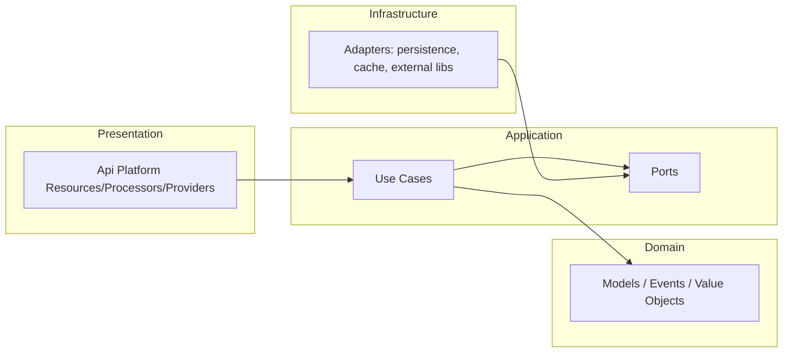

# Module Architecture Standard

**Reading guide:** [Documentation index](docs/README.md) · [Related guide](docs/architecture/patterns-and-examples.md).

This document defines how to build a complete module in this repo.
It captures the shared standards (hexagonal architecture, Api Platform,
ports/adapters, tests, and documentation). It is intentionally generic
and does not describe a specific module or protocol.

## Goals

- Provide a consistent module layout and naming scheme.
- Keep business logic in use cases, not in processors/controllers.
- Make dependencies explicit through ports and adapters.
- Ensure configuration, documentation, and tests are complete.

## Core Principles

- Hexagonal architecture (Ports and Adapters).
- One-way dependencies:
  - Presentation -> Application -> Domain
  - Infrastructure -> Application (implements ports)
  - Domain has no dependency on other layers.
- Use cases are the single entry point for business logic.
- External libraries are always behind adapters.



## Standard Directory Layout

Use this structure for any module (replace `<Module>`):

```
src/<Module>/
  Application/
    Contract/      (optional, cross-module contract types)
      <Area>/      (optional, group contract types by context)
    Port/
      Outbound/
        <Area>/      (optional, group ports by context)
        Internal/    (optional, owner-private ports; never consumed by another module)
          <Area>/    (optional, group private persistence or model-oriented ports)
      Inbound/        (optional)
        <Area>/      (optional, group ports by context)
        Internal/    (optional, owner-private inbound capabilities)
    Service/
    UseCase/
      Command/
        <Area>/
          <UseCase>/
            <UseCase>Command.php
            <UseCase>Handler.php
            <UseCase>Result.php
      Query/
        <Area>/
          <UseCase>/
            <UseCase>Query.php
            <UseCase>Handler.php
            <UseCase>Result.php
  Domain/
    Model/
      <Aggregate>/
    ValueObject/
    Event/
    Exception/
  Infrastructure/
    Adapter/
    Persistence/Doctrine/
      Repository/
      Record/
      Mapper/              (optional)
    Cache/                (optional)
    <Context>/            (optional, dedicated integration)
      Adapter/
      Entity/             (optional)
      Repository/         (optional)
      Server/             (optional)
    Console/
    DataFixtures/
    EventSubscriber/
  Presentation/
    Api/
      Resource/
      Operation/
      Processor/
      Provider/
      Service/              (optional, presentation helpers)
      Dto/
        Input/
          <Area>/
        Output/
          <Area>/
      Validator/
        <Rule>/
      EventSubscriber/
      Serialization/
```

Pure owner-local aggregate-to-contract projections use `*ViewMapper` in
`Application/Service`. HTTP exception translation uses `*ExceptionMapper` in
`Presentation/Api/Service`. Record-to-aggregate persistence mappers remain in
`Infrastructure/Persistence`. These names do not permit Doctrine or foreign private
types in Application or Presentation; the layer and module dependency gates still apply.

### Context-Oriented Subfolder Examples

Use a dedicated context folder when an integration grows beyond a single adapter.
Examples of context layouts (replace names with your domain):

```
Infrastructure/
  Persistence/Doctrine/
    Repository/
    Record/
    Mapper/

  Identity/
    Adapter/

  OAuth2/League/
    Entity/
    Repository/
    Server/

  Oidc/
    Adapter/

  Payment/
    Adapter/

  Notification/
    Adapter/
```

### Validation Subfolder Example

Custom validators use their own folder:

```
Presentation/Api/Validator/
  ValidRedirectUri/
    ValidRedirectUri.php
    ValidRedirectUriValidator.php
```

### Use Case Grouping Example

Group use cases by area to keep the Application layer readable:

```
Application/UseCase/
  Command/
    Client/
      RegisterClient/
      UpdateClient/
    Token/
      IssueToken/
      RevokeToken/
  Query/
    Client/
      GetClient/
      ListClients/
    Token/
      IntrospectToken/
```

### Presentation Subfolder Examples

Organize API concerns by area (replace with your module areas):

```
Presentation/Api/
  Resource/
    ClientResource.php
    TokenResource.php
  Operation/
    ClientOperations.php
    TokenOperations.php
  Processor/
    Client/
      CreateClientProcessor.php
      UpdateClientProcessor.php
    Token/
      IssueTokenProcessor.php
      RevokeTokenProcessor.php
  Provider/
    Client/
      ClientProvider.php
  Service/
    CookieService.php
```

## Naming Conventions

- UseCase:
  - Command: `<Action>Command`, Handler: `<Action>Handler`, Result: `<Action>Result`
  - Query: `<Action>Query`, Handler: `<Action>Handler`, Result: `<Action>Result`
- Ports: `<Capability>Port` (interfaces in Application/Port)
- Adapters: `<Capability>Adapter` or `<Entity>Repository`
- Processors: `<Action>Processor`
- Providers: `<Resource>Provider`
- DTOs: `<Action>Input`, `<Action>Output`
- Operations: `<Module>Operations` with route constants
- Contracts: keep stable enums/DTOs under `Application/Contract`, and prefer names distinct from use case results

Keep namespaces aligned with folder layout.

## Application Layer Standard

### Use Cases

- Implement business logic in handlers, not in processors.
- Use CommandBusPort for writes and QueryBusPort for reads.
- Return Result objects, not raw arrays.
- Emit domain events for significant state changes.

### Ports

- Define external dependencies as ports under Application/Port/Outbound.
- Group ports by area under `Application/Port/Outbound/<Area>` and `Application/Port/Inbound/<Area>` when it keeps the Application layer readable.
- Do not reference infrastructure classes in handlers.
- If another module is required, depend on its port and contract types, not its adapter or domain.

Example registration (config/modules/<module>.yaml):

```
<Module>\Application\Port\Outbound\FooPort:
  alias: <Module>\Infrastructure\Adapter\FooAdapter
```

### Contracts

- Expose cross-module types (enums/DTOs) under `Application/Contract`.
- Ports may reference contract types; do not expose Domain types outside the module.
- Keep contract types stable and independent from framework/persistence details.
- Publish immutable aggregate snapshots and typed capabilities across modules.
  Aggregate instances, persistence Records and model-oriented repositories remain
  owner-private; owner-local view mappers produce the public contract. Consumers
  do not assemble business invariants by reading another module's private state.
- Business catalog keys are open, syntactically validated identifiers. Owners publish
  typed definitions through application contribution ports; registries order those
  definitions and reject duplicate ownership during container boot. New writes and
  execution require a registered key. Historical hydration preserves valid persisted
  keys even when their contributor is absent. Technical protocol, lifecycle and
  transaction-state enums remain closed.
- `Application/Port/{Inbound,Outbound}/Internal` contains owner-private ports that expose the owner's
  Domain models or other private types. Preserve the port's direction; repositories normally
  belong under `Outbound/Internal`. Their public
  counterparts expose pure contract snapshots or capabilities instead. Migrate foreign
  consumers to those published capabilities before moving a port into `Internal`.

## Presentation Layer Standard (Api Platform)

- Define resources under Presentation/Api/Resource.
- Define operations under Presentation/Api/Operation.
- Implement processors/providers under Presentation/Api/Processor and Provider.
- Use Input/Output DTOs with serialization groups.
- Use Symfony Validator constraints and custom validators for complex rules.
- Centralize error mapping via EventSubscriber when needed.

### Reference Catalog Endpoints

Use dedicated reference catalog resources for UI selects only when the API contract benefits from exposing them explicitly.

Preferred categories:

- `Static contract`: stable enum-like values with no scope, permission, or contextual metadata. Do not create an endpoint by default when OpenAPI or a shared contract is sufficient.
- `Reference catalog`: read-only lists meant for selects, filters, or lightweight UI metadata. Expose these as dedicated `GetCollection` resources under the owning module.
- `Business resource`: real domain collections with lifecycle, relationships, search, pagination, or write behavior. Keep these as normal resources, not as simplified option endpoints.

Use a reference catalog resource when at least one of these is true:

- the frontend should not hard-code the values
- labels or display metadata belong to the backend contract
- values may evolve without a frontend redeploy
- the list depends on permissions, tenant, organization, country, or another context
- the response needs more than a bare string list

Guidelines for reference catalogs:

- prefer module-local routes such as `/facilities/statuses`, `/inspections/results`, `/organizations/legal-types`
- avoid generic utility endpoints such as `/options`, `/lookups`, `/metadata/selects`, or aggregated multi-list payloads by default
- keep providers thin; they may read directly from enums or registries when the list is static
- use a minimal output contract such as `value` and `label`, and add metadata only when the frontend really needs it
- keep resource-level security as the coarse gate and add explicit permission or scope checks in providers whenever the list is contextual

This keeps select data explicit and documented without degrading real business resources into generic option feeds.

Checklist for each endpoint:

- Resource with proper route and security.
- Operation constant and metadata.
- Input/Output DTOs.
- Processor (write) or Provider (read).
- Validation rules and error mapping.
- Functional tests for success and error cases.

## Domain Layer Standard

- Models and ValueObjects enforce invariants.
- Exceptions define domain errors that map to API errors.
- Events capture significant state changes.
- Domain must not depend on Application, Presentation, or Infrastructure.

## Infrastructure Layer Standard

- Adapters implement ports for external systems:
  - Persistence (Doctrine repositories)
  - External services (vendor APIs, protocols)
  - Cache
  - Messaging/logging integrations
- Keep persistence logic in repositories (no business rules).
- Hide third party library types behind adapters.
- If a module needs a dedicated integration, create a new folder under
  Infrastructure with its own Adapter subfolder (no global External folder).

## Configuration Standards

### Service Wiring

`config/packages/modules.yaml` selects the full FireGuard production composition.
Each `config/modules/<owner>.yaml` is the service entry point and imports only its
owner's configuration fragments. Selecting a module contributes its services and
metadata together:

| Fragment under `config/modules/<owner>/` | Owner contribution |
| --- | --- |
| `doctrine.yaml` | Record mapping namespace and its explicit auth/main entity manager |
| `api_platform.yaml` | Resource discovery paths and module exception-to-status mappings |
| `framework*.yaml` | Messenger transports, message routing and other owned framework settings |
| `seeds.yaml` | Environment-scoped fixture services, seed identifiers and prerequisite order |

Global Doctrine configuration retains the connection and entity-manager definitions;
it does not enumerate business mappings. Package configuration retains shared
framework defaults. Module services alias ports to adapters and explicitly select
the entity manager and transaction owner. Production keeps its complete module set,
routes, transports, persisted values and existing migration histories.

Owners publish existing scalar foreign keys and partial indexes through
[`SchemaContributionPort`](src/Shared/Application/Port/Outbound/Schema/SchemaContributionPort.php),
tagged `shared.schema_contribution`. Shared's schema listeners apply those descriptors
only to the relevant manager's generated schema. Names, columns, predicates and SQL
semantics remain identical; a descriptor does not create a replacement schema or a
cross-database constraint.

Catalogs, event conversion, audit mapping and operation capabilities use explicit
module contributions through published ports/contracts. Contributions remain
framework-free at the application boundary and keep policy in the owning module.
Changing a contributor requires the owner's wiring, tests and MODULE.md in the same
change; a shared engine must not import business models to discover behavior.

Keep deployment-controlled settings in package configuration and environment
references, with example values in `.env.example` or `.env.dist` only.

### Mutation and replay contracts

Every client write declares an owner-published
[`HttpIdempotencyOperation`](src/Shared/Application/Contract/Http/HttpIdempotencyOperation.php):
stable operation name, auth/main database, final transaction mode, primary command,
typed result schema and any additional immutable result contracts. The HTTP layer
checks current authorization and scope before either execution or replay. Callbacks
use their verified provider-native event identity instead of a browser-supplied key.

Ordinary commands use the declared bus transaction owner. Media commands retain
their root transaction and reject an enclosing transaction before writing bytes.
The application result snapshot and receipt complete before the owning business
commit. A confirmed rollback permits retry; an indeterminate commit requires
reconciliation and must not repeat the effect. No receipt or transaction spans auth
and main. See [Security](SECURITY.md#durable-http-idempotency) for replay proof and
retention requirements and [Operations](OPERATIONS.md#http-idempotency-rollout) for
the staged client cutover.

### Security

- Add API access rules in `config/packages/security.yaml`.
- Keep public endpoints explicit and limited.
- Use roles or scopes per endpoint where applicable.

### Rate Limiting (Optional)

- Define limiters in `config/packages/rate_limiter.yaml`.
- Inject limiter into processors with `#[Autowire(service: 'limiter.<name>')]`.

## Documentation Standard (MODULE.md)

Each module must have `src/<Module>/MODULE.md` with:

- Overview
- API endpoints (table)
- Flows (sequence diagrams)
- Architecture
- Configuration
- Testing
- Error codes (if applicable)

Keep MODULE.md current with code changes.

## Testing Standard

- Unit: `tests/Unit/<Module>`
  - Handlers
  - Adapters
  - Domain models/value objects
- Functional: `tests/Functional/Api`
  - Endpoint contract tests
- E2E: `tests/E2E`
  - Full flows across endpoints

Minimum tests for a new endpoint:

- Processor or provider unit test
- Use case handler unit test
- Functional API test

## Module Completion Checklist

- [ ] Directory layout matches the standard.
- [ ] Use cases live in Application/UseCase.
- [ ] Ports exist for external dependencies.
- [ ] Adapters implement ports and are wired in config.
- [ ] DTOs, validators, processors/providers exist per endpoint.
- [ ] Errors are normalized and documented.
- [ ] Security rules are configured.
- [ ] Rate limiting configured where needed.
- [ ] MODULE.md updated.
- [ ] Unit + functional tests exist.

## Refactor Checklist for Existing Modules

- [ ] Move business logic out of processors/controllers into handlers.
- [ ] Replace direct infrastructure usage with ports.
- [ ] Add missing DTOs, validation, and error mapping.
- [ ] Align directory layout and naming.
- [ ] Add missing tests and documentation.

## Executable module boundary gate

The separate [core composition suite](tests/Composition/phpunit.xml) boots
[`CoreKernel`](tests/Support/Kernel/CoreKernel.php) with exactly Shared, Auth, OAuth,
User, Session, Otp, TrustedDevice, Authorization, Tenant, Audit and Notification.
It inspects actual services, routes, resource metadata, receivers and ORM ownership,
and exercises the protected-route denial path. It uses clones of the full migrated
PostgreSQL test templates; unselected tables may exist but are not mapped or exposed.
This is a composition proof, not another starter application or migration history.

Run `php -d memory_limit=1G vendor/bin/phpunit -c tests/Composition/phpunit.xml`
after owner discovery or composition changes, in addition to the full production
container and relevant endpoint/schema checks.

`make deptrac` and CI run both the original layer rules and `tests/Architecture/deptrac/modules.php`.
Each documented module has disjoint public (`Application/Port`, except
`Application/Port/{Inbound,Outbound}/Internal`, and `Application/Contract`)
and private collectors. Only public surfaces cross module boundaries. Shared's existing
Domain kernel and message-handler contracts are explicitly public infrastructure contracts.
No business consumer, including Audit, is exempt. Native AST analysis also sees fully qualified
names, inheritance and signatures, not just textual `use` statements.

`tests/Architecture/deptrac/modules.baseline.yaml` enumerates existing **exact class pairs**, including technical
HTTP/security helpers, legacy Domain types, event subscriptions, and fixture composition.
These entries are visible migration debt, not new public APIs. Fix touched dependencies when
practical and remove their exceptions. Do not regenerate the baseline to accept new violations;
new functionality consumes owner-published ports/contracts. Vendor/PHP references outside the
module namespace layers remain uncovered and are governed by the layer gate and PHPStan.
The earlier Domain-import count test remains an additional ratchet.
