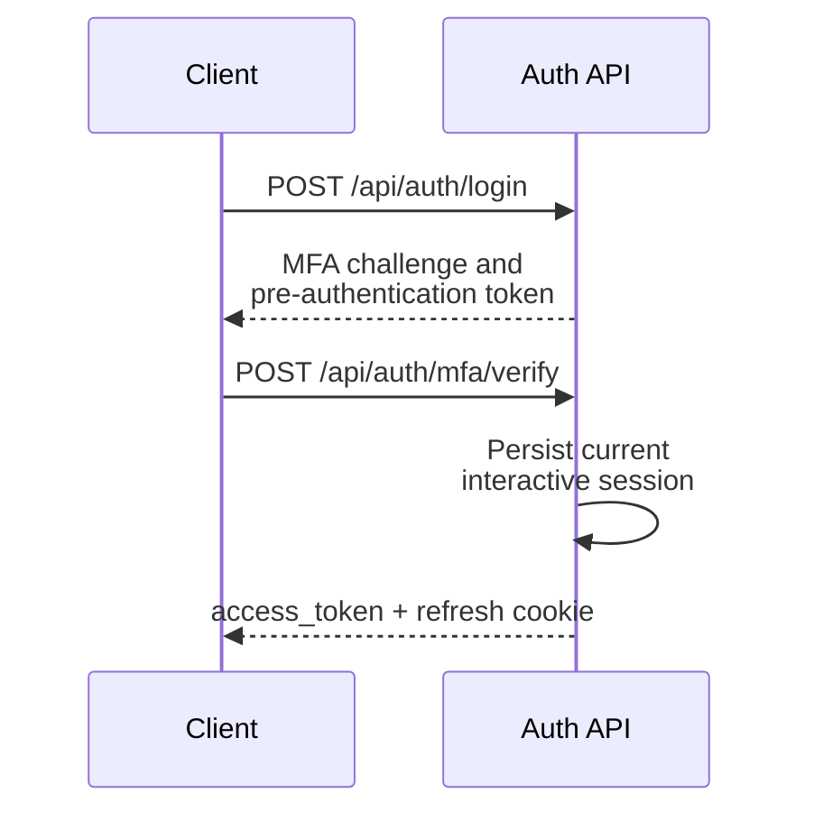
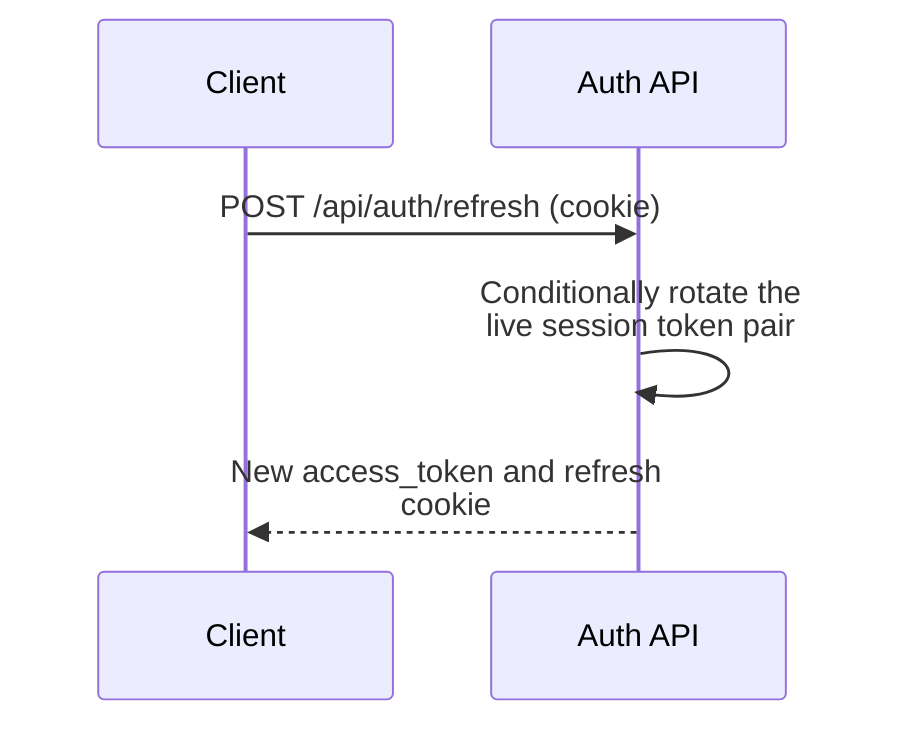
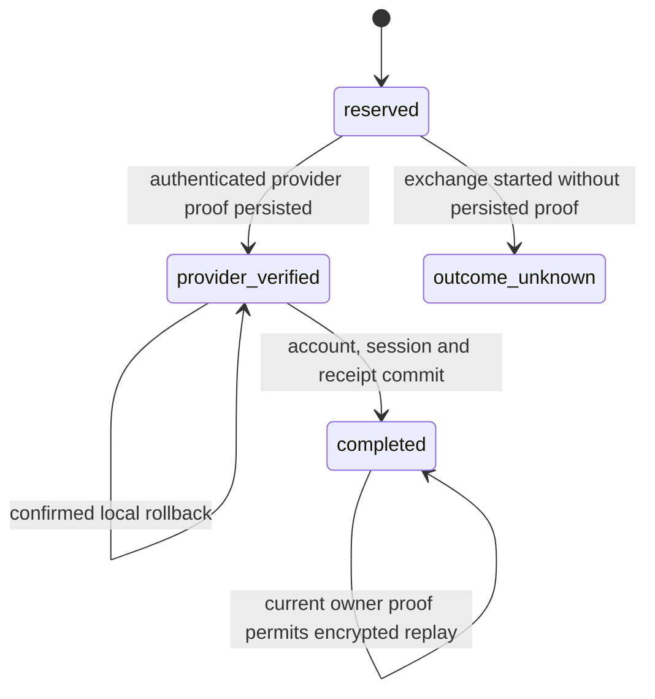

# Auth Module

**Reading guide:** [Documentation index](../../docs/README.md) · [Related guide](../../docs/guides/authentication.md).

Authentication module for Fireguard API. It provides user login, MFA verification, refresh token handling, and logout, while integrating with the OAuth2 and OpenID Connect stack.

## Overview

The Auth module is responsible for interactive user authentication. It issues access and refresh tokens, manages MFA challenges, and maintains secure refresh token cookies.

Its final `TokenExpiry` value object consumes Shared's `HasTokenExpiry` trait while retaining its constructor, computed properties, concrete factory type and absolute expiration behavior.

## Features

- Email or username authentication with password.
- Optional MFA with OTP (email, SMS, TOTP).
- Refresh token cookies with HttpOnly, SameSite, and secure defaults.
- Access tokens are minimized by default; optional email/RBAC claims via env.
- Session tracking and revocation.
- Integration with OAuth2/OpenID Connect flows.

## API Endpoints

`GET /api/auth/password-policy` is public and read-only. It returns the configured
`minimumLength`, `maximumLength`, `requireUppercase`, `requireLowercase`, `requireDigit`,
`specialCharacters` and nullable `allowedInitialCharacters`. An empty special-character alphabet disables that requirement; a null initial-character alphabet permits any first character.
Password creation inputs refer to this runtime contract instead of fixed OpenAPI length bounds.

| Mailbox proof endpoint              | Method | Authentication                  |
| ----------------------------------- | ------ | ------------------------------- |
| `/api/auth/email-ownership`         | GET    | ROLE_USER                       |
| `/api/auth/email-ownership/start`   | POST   | ROLE_USER + per-user rate limit |
| `/api/auth/email-ownership/confirm` | POST   | ROLE_USER + per-user rate limit |

### Authentication

#### POST `/api/auth/login`

Authenticates a user using email and password.

Request:

```json
{
  "email": "john.doe@example.com",
  "password": "SecureP@ssw0rd!",
  "remember_me": false
}
```

| Field         | Type    | Required | Description                       |
| ------------- | ------- | -------- | --------------------------------- |
| `email`       | string  | Yes      | Valid email address               |
| `password`    | string  | Yes      | User password (min 8 chars)       |
| `remember_me` | boolean | No       | Extend session duration (30 days) |

Success response (200):

```json
{
  "access_token": "eyJhbGciOiJSUzI1NiIsInR5cCI6IkpXVCJ9...",
  "token_type": "Bearer",
  "expires_in": 3600,
  "scope": "openid profile email"
}
```

If MFA is required (200):

```json
{
  "mfa_required": true,
  "mfa_token": "eyJ...",
  "challenge_token": "abc123..."
}
```

Notes:

- A HttpOnly refresh token cookie is set in the response.
- The refresh token cookie is not readable by JavaScript.
- Login validation and refusal messages follow `Accept-Language` (`en`, `fr`, `es`),
  with English as the default. Validation responses retain their structured `violations`.

#### POST `/api/auth/mfa/verify`

Verifies the OTP to complete MFA.

Request:

```json
{
  "preAuthToken": "eyJ...",
  "code": "123456"
}
```

| Field          | Type   | Required | Description                                                                                  |
| -------------- | ------ | -------- | -------------------------------------------------------------------------------------------- |
| `preAuthToken` | string | Yes      | Token received in `mfa_token`                                                                |
| `code`         | string | Yes      | OTP/TOTP code (length: `OTP_CODE_LENGTH` for SMS/Email, `TOTP_DIGITS` for authenticator app) |

#### POST `/api/auth/mfa/resend`

Resends the MFA OTP code using the pre-auth token.

Request:

```json
{
  "preAuthToken": "eyJ..."
}
```

Response (200):

```json
{
  "mfa_required": true,
  "mfa_token": "eyJ...",
  "challenge_token": "abc123..."
}
```

Notes:

- Returns a **new** `mfa_token` and `challenge_token` to use for verification.
- Subject to cooldown and rate limiting.
- Returns `400 Bad Request` with `errorCode: "totp_not_resendable"` when the
  active challenge channel is `totp` (authenticator codes cannot be resent).

#### POST `/api/auth/refresh`

Refreshes the access token using the refresh token cookie.

Response (200):

```json
{
  "access_token": "eyJ...",
  "token_type": "Bearer",
  "expires_in": 3600
}
```

Notes:

- No request body is required.
- The refresh token is read from the HttpOnly cookie.

#### POST `/api/auth/logout`

Revokes tokens and clears the refresh token cookie.

Headers:

```http
Authorization: Bearer <access_token>
```

Response (200):

```json
{
  "success": true,
  "message": "Logout successful"
}
```

#### Rate-limit responses

Login, token refresh, MFA verification and MFA resend return `429 Too Many Requests`
with `Content-Type: application/problem+json`, regardless of the request's `Accept` header.
The problem details include `code: "rate_limit_exceeded"` and `retryAfterSeconds`, a
non-negative integer or `null` when the retry delay is unknown. The `Retry-After` header
is preserved when supplied by the limiter.

### Password Reset

#### POST `/api/auth/password/reset/request`

Request a password reset by email. An OTP code will be sent if the account exists.

Request:

```json
{
  "email": "john.doe@example.com"
}
```

| Field   | Type   | Required | Description          |
| ------- | ------ | -------- | -------------------- |
| `email` | string | Yes      | User's email address |

Response (200):

```json
{
  "success": true,
  "message": "If an account exists with this email, you will receive a password reset code."
}
```

Notes:

- Always returns success to prevent user enumeration
- OTP code is sent via email (15 min expiry, 5 attempts max)

#### POST `/api/auth/password/reset/confirm`

Confirm password reset using the token, code, and new password.

Request:

```json
{
  "token": "abc123...",
  "code": "123456",
  "newPassword": "NewSecureP@ss123!"
}
```

| Field         | Type   | Required | Description                                                                        |
| ------------- | ------ | -------- | ---------------------------------------------------------------------------------- |
| `token`       | string | Yes      | Challenge token from request step                                                  |
| `code`        | string | Yes      | OTP code received by email                                                         |
| `newPassword` | string | Yes      | New password (min 8 chars, must include uppercase, lowercase, digit, special char) |

Response (200):

```json
{
  "success": true,
  "message": "Password has been reset successfully. All active sessions have been terminated."
}
```

Error response (401):

```json
{
  "success": false,
  "message": "Invalid verification code. Please check and try again.",
  "errorCode": "invalid_code",
  "attemptsRemaining": 3
}
```

Notes:

- All active sessions are revoked on success
- All OAuth tokens are revoked on success
- Error codes: `invalid_code`, `expired`, `max_attempts_exceeded`, `invalid_token`

### OAuth2 and Discovery

This module integrates with the OAuth module for authorization, token issuance, and discovery. For full details, see `src/OAuth/MODULE.md`.

Core endpoints:

- `/api/oauth2/authorize`
- `/api/oauth2/token`
- `/api/oauth2/token/introspect`
- `/api/oauth2/token/revoke`
- `/api/oauth2/userinfo`
- `/api/oauth2/logout`
- `/api/.well-known/openid-configuration`
- `/api/.well-known/jwks.json`

### Organization-discovery email proof

`GET /api/auth/email-ownership` returns `{verified}` for the authenticated account.
`POST /api/auth/email-ownership/start` sends a code to its current email and returns
`{challengeToken, canResendIn}`. `POST /api/auth/email-ownership/confirm` accepts
`{challengeToken, code}` and returns `{verified: true}`. No user ID or email is accepted
from the browser. All three require `ROLE_USER`; start is limited to one request per
minute per user, confirmation to ten requests per minute. The dedicated challenge expires
after ten minutes and permits five code attempts. A rejected challenge returns
`email_ownership_invalid_challenge` (400), without revealing token, code or mailbox.
An inactive account or concurrent address change returns `email_ownership_unavailable` (403).
This proof is independent of OAuth provider claims and does not bypass Fireguard MFA.

## Flows

### Login with MFA

Password login issues a pre-authentication challenge. MFA completion must persist the interactive session before returning its access token and refresh cookie.



### Refresh Token

Refresh conditionally rotates a live session token pair. A consumed or revoked pair returns no new token, and the previous access token stops authenticating.



## Refresh Token Policy

- Access token TTL: `ACCESS_TOKEN_TTL` (seconds).
- Refresh token TTLs:
  - Short: `REFRESH_TOKEN_LIFETIME_SHORT` (default for non-remembered sessions).
  - Long: `REFRESH_TOKEN_LIFETIME_LONG` (used when `remember_me=true`).
- Interactive refresh consumes the previous access/refresh pair with one conditional
  update in `auth`. Only a live session can rotate; concurrent or replayed refreshes
  receive no tokens. The old access token stops authenticating after rotation.
- Logout revokes refresh tokens and clears the refresh token cookie.

## MFA & OTP

- `/api/auth/mfa/verify` completes MFA using a pre-auth token and OTP/TOTP code.
- General OTP flows (email/SMS challenges and TOTP setup/confirm/disable) are
  exposed in the OTP module: see `src/Otp/MODULE.md`.
- OTP endpoints require `otp_*` permissions and are intended for authenticated
  user flows or internal service usage.

### MFA channel selection

- `LoginHandler` picks the MFA channel per login attempt: if the user has an
  **ACTIVE** TOTP enrollment (checked via `Auth\Application\Port\Outbound\Mfa\TotpEnrollmentCheckPort`,
  implemented in the Otp module), the channel is `totp` and **no email is
  sent** — the user enters the current code from their authenticator app.
  Otherwise the channel falls back to `email`.
- This is an either/or choice per login, not a multi-method selector: a user
  with active TOTP no longer receives email MFA codes at login. This keeps
  the pre-auth token/challenge model (one challenge token, one channel)
  unchanged rather than introducing a method-selection step.
- `/api/auth/mfa/resend` is a no-op (`400 Bad Request`, `errorCode:
"totp_not_resendable"`) when the active challenge's channel is `totp`,
  since TOTP codes are generated locally and cannot be "resent".
- If `TotpEnrollmentCheckPort` fails technically, sign-in fails without generating
  an email challenge or session credentials. Email MFA is selected only after a
  successful lookup confirms that no active TOTP factor exists.

## Integration Examples

Login:

```bash
curl -X POST http://localhost:8000/api/auth/login \
  -H "Content-Type: application/json" \
  -d '{"email":"john.doe@example.com","password":"SecureP@ssw0rd!","remember_me":false}'
```

Refresh (using cookie jar):

```bash
curl -X POST http://localhost:8000/api/auth/refresh \
  -H "Content-Type: application/json" \
  -b cookies.txt
```

OIDC Authorization Code + PKCE:

1. Redirect the user to `/api/oauth2/authorize` with PKCE parameters.
2. Exchange the code at `/api/oauth2/token`.
3. Use the access token for protected APIs and `/api/oauth2/userinfo`.

See `src/OAuth/MODULE.md` for the full OAuth2/OIDC flow.

## Architecture

- Presentation: Api Platform resources, processors, and providers.
- Application: Use cases and ports for login, MFA verification, refresh, and logout.
- Domain: Session and token aggregates with events.
- Infrastructure: JWT adapters, rate limiting, session tracking, and security voters.

Key folders:

- `src/Auth/Presentation/Api`
- `src/Auth/Application/UseCase`
- `src/Auth/Domain`
- `src/Auth/Infrastructure`

### How `OAuth2Authenticator` validates a bearer token

The order matters, and each step exists because skipping it was a defect:

1. **Signature, always.** Verified before any claim is read as trusted. Both
   issuance paths sign with `config/jwt/private.key`, so one verification key
   covers both. This must never become conditional: the database lookup keys on
   `jti` and never binds it back to `sub`, so an unverified token reusing a live
   `jti` with an arbitrary `sub` would authenticate as that subject.
2. **Expiry**, from the now-trusted claims.
3. **Revocation**, and here the two token kinds diverge:
   - `_fireguard_token_use: auth_session` (login flow) — resolved through
     `Auth\Application\Port\Outbound\SessionStatusPort`, since these tokens have
     no row in the OAuth2 token table and the session carries their revocation
     state. A current, non-revoked session must match both the token identifier
     and the signed user identifier. Issuance persists that anchor before exposing
     tokens or announcing login success. Missing or rotated tokens are rejected.
     See `src/Session/MODULE.md`.
   - everything else (OAuth2 flow) — resolved through `AccessTokenLookupPort`,
     which requires an existing record and is also authoritative on an expiry
     preceding the token's own. MFA `pre_auth` tokens cannot authenticate an API
     request. Inactive user accounts are rejected when loading the passport.

### Published and private capabilities

Federation and initial password setup enter through typed command/query handlers. HTTP owns cookies and rate limits; Application preserves browser binding, state, PKCE, nonce, locks and principal checks. FederatedExceptionSubscriber maps bus-wrapped failures centrally to the existing 400/401/409 codes. Open provider identifiers, grant enums and issued-session snapshots are pure contracts.

Password flows consume User-owned credential/registration capabilities and Otp-owned challenge projections. Confirmation binds expected purpose and, for authenticated changes, owner. Owner modules persist attempts and account transitions. AuthenticatedUser/AuthenticatedPrincipal expose verified identity without security infrastructure. Retention delegates each foreign dataset to its owner; Auth cleans its own federation flows.

Repositories and capabilities exposing owner-local types are private under Application/Port/Outbound/Internal; cross-module access uses published ports and pure contracts.

## Configuration

`AuthenticationPolicyPort` exposes explicit project choices from
`config/packages/authentication_policy.yaml`: self-service signup, required registration
email verification, trusted-device MFA bypass and federated account provisioning default
to enabled. Global MFA retains the deployed `MFA_ENABLED` value. Disabling signup returns
403 (`registration_disabled`) before account lookup or creation. Waiving registration
verification activates the account and skips its verification challenge; it does not
set `emailVerified` or establish Fireguard mailbox-ownership proof. Disabled or locked
accounts remain ineligible for sign-in. Disabling trusted-device bypass always requires
the configured MFA flow, retaining TOTP factor selection and fail-closed enrollment checks.

Creation/reset/change/first-password flows consume User's authoritative PasswordPolicyPort.
They validate plaintext before an OTP can be consumed, including direct commands without
HTTP validation. Sign-in checks the stored credential without reapplying creation rules;
its transport accepts non-empty passwords up to 4,096 characters so a later policy change
does not lock out legacy credentials. Default creation validation messages remain stable;
custom-rule messages describe the configured requirements.

Environment variables (see `.env`):

- `MFA_ENABLED`
- `ACCESS_TOKEN_INCLUDE_EMAIL` (default: `true` for backward compatibility)
- `ACCESS_TOKEN_INCLUDE_RBAC` (default: `true` for backward compatibility)
- `REFRESH_TOKEN_COOKIE_NAME`
- `REFRESH_TOKEN_LIFETIME_SHORT`
- `REFRESH_TOKEN_LIFETIME_LONG`
- `TRUSTED_DEVICE_COOKIE_NAME`
- `TRUSTED_DEVICE_LIFETIME`
- `OAUTH_ISSUER`

Service wiring:

- `config/modules/auth.yaml`

## OAuth delegation boundaries

The request scope gate runs after verified authentication and before API providers or
processors. It intersects OAuth capabilities with the existing RBAC and organization
checks. READ permits GET/HEAD/OPTIONS; WRITE permits POST/PUT/PATCH; DELETE permits
DELETE. These capabilities are independent: ADMIN does not imply READ, and WRITE does
not imply DELETE. The read-only `workload_assess` POST requires READ.

Routed client, tenant, user, permission and role administration resources require
ADMIN, including organization role assignments. OAuth authorization and consent
operations also require ADMIN when called using a delegated OAuth bearer. Selection
uses canonical routed resource and operation metadata, so URL encoding and format
suffixes cannot alter the required capability. Unknown methods require ADMIN.

Only OAuth UserInfo GET and token introspection/revocation POST are exempt protocol
operations; their own identity and authentication requirements still apply. A signed
`auth_session` token with a matching active issuing session retains interactive
permissions. Delegated OAuth tokens cannot select that exemption.

Password reset/change and email change revoke interactive sessions and all stored
user-bound OAuth access tokens, linked refresh tokens and unused authorization codes.
Storage revocation commits atomically before token-cache invalidation; failures
propagate to the credential workflow.

## Testing

- Unit: `tests/Unit/Auth`
- Integration: `tests/Integration/Auth`
- End-to-end: `tests/E2E` (auth flows)

## Federated authentication

Federated presentation errors keep one status per typed exception:
FederatedAuthException maps to 400, FederatedConflictException to 409, and
FederatedUnauthorizedException to 401. Their stable public error codes remain
the frontend branching contract.

Federated sign-in belongs to Auth and uses Authorization Code with PKCE S256. Google and Microsoft keep their existing provider clients and identifiers. Auth stores
only a hashed one-time state and an encrypted PKCE verifier for ten minutes. Provider access tokens
exist only while the callback request exchanges them for a Fireguard session. Microsoft uses the
`common` authority so personal, work and school accounts share one configured application.

Federated authorization starts remain JSON `POST` operations for login and linking.
They require an explicit `Idempotency-Key` before dispatch. The existing HttpOnly flow
cookie holds a random server-authenticated browser ticket with a fixed ten-minute
deadline. The first start issues it; retries reuse its verified identity and original
expiry. A key cannot replace browser possession or authorize another browser's stored
response. Login and link intents remain distinct, and linking also checks the current
account revision.

Start responses use encrypted replay for at most five minutes inside the owning auth
command transaction. Repeated requests preserve the authorization state, OIDC nonce and
PKCE verifier. Before decoding the stored URL, Auth reads the exact current reserved flow
and rejects expired, consumed or already-exchanging state. Retries never provision an
account, exchange a code or extend the initial cookie deadline. There is no stateful GET
start route.

An unknown provider subject may provision an active, email-verified User without a password. A
provider email that already belongs to an unlinked User returns `account_exists`; email equality never
links accounts. Linking is an authenticated flow from `/account/security`, and unlinking preserves at
least one usable method. Federated login calls `SessionIssuer`, the same application service as
password login, so MFA, trusted devices, refresh cookies, session tracking and login auditing keep the
same behavior.

Configuration uses `GOOGLE_OIDC_*` and `MICROSOFT_OIDC_*`. The backend derives login and link callback
URLs from `APP_FRONTEND_URL`; the browser cannot supply a redirect URI. Provider availability is
public, while connection and password-setup endpoints require an authenticated user.
Both legacy providers default to disabled with empty credentials when their optional
environment variables are absent. Explicit enablement and both credentials are required
before either provider is available; existing deployment values override these defaults.

Generic OIDC providers are registered only in `config/packages/federated_providers.yaml`.
A stable provider key contains at most twenty lowercase letters, digits, underscores or
hyphens and begins with a letter. Public descriptors retain `provider` and `enabled`,
and add `id`, `value` and `label`; enabled providers are listed without publishing
issuers, endpoints or credentials. Unknown and disabled providers cannot begin or
complete authentication. Generic entries cannot replace the `google` or `microsoft`
keys.

Each generic registration supplies an exact HTTPS issuer and server-owned HTTPS
authorization, token and JWKS endpoints, optional UserInfo endpoint and confidential
client credentials through environment references. HTTP redirects are disabled for
credential and key requests. Generic authorization generates a fresh nonce; only its
SHA-256 hash is retained alongside the browser-bound state and encrypted PKCE verifier.
Completion requires a matching RS256 signing key from the configured JWKS before any
claim is trusted, then validates issuer, audience/authorized party, expiration,
issuance time and nonce. UserInfo, when used, must return the same signed subject.
Email verification is bound to its exact address: a changed UserInfo email cannot inherit
the ID token's verification of another address. The same address retains the signed proof
when UserInfo omits `email_verified`; an explicit UserInfo proof replaces it only for
the address provided by UserInfo. An isolated `email_verified: true` without an address
cannot promote an unverified ID token email.
A verified email never links an existing account implicitly.

Generic connections persist the verified issuer, and later mismatches deny authentication
and linking; changing an issuer requires a new provider key. Generic sign-in uses the
`federated_oidc` grant and the stable account method `oidc`, through the ordinary MFA
and interactive session path. Project policy can disable new federated account
provisioning while preserving existing connections. Auth migration
`Version20261011000200` adds nullable nonce and issuer columns for rollout compatibility;
apply it before enabling generic providers.


## Error Codes

- `registration_disabled` -> 403, self-service signup is disabled by project configuration

- `AuthenticationException` -> invalid credentials or user state
- `AuthorizationException` -> unauthorized access
- `MfaChallengeException` -> invalid or expired MFA challenge
- `TokenRevocationException` -> token revocation failed
- `rate_limit_exceeded` -> HTTP 429; see the rate-limit response contract above
- `unknown_provider`, `provider_unavailable` -> unsupported or disabled provider
- `invalid_flow` -> expired, consumed or replayed state
- `account_exists` -> provider email belongs to an existing unlinked account
- `identity_linked`, `provider_already_linked` -> provider identity conflict
- `email_unverified`, `account_unavailable` -> provider or account cannot authenticate
- `last_sign_in_method` -> disconnect would remove the final usable credential
- `invalid_identity`, `identity_mismatch`, `issuer_mismatch` -> provider proof or identity namespace rejected
- `federated_provisioning_disabled` -> project policy refuses a new federated account

`Auth\Application\Contract\User\AuthenticatedUser` exposes the stable user identifier
to authenticated presentation code in other modules. `SecurityUser` implements this
contract; new consumers depend on the contract rather than Auth infrastructure.

## Credential lifecycle HTTP receipts

Auth contributes explicit auth-database ownership for registration, password reset/change/setup,
mailbox proof start/confirm and MFA resend. These secret-bearing application results have a
five-minute encrypted receipt window. The original password, OTP, challenge and signed
preauthentication token are canonical HMAC input; receipt metadata contains only non-secret
owner IDs, credential revisions, mailbox hashes and challenge/session lifecycle facts.

Every attempt checks fresh User and Otp owner ports before result decryption. Authenticated
operations also recheck the current actor and exact current `ROLE_USER` requirement. A later
credential revision, mailbox change, account revocation, challenge replacement/consumption or
session revocation invalidates the associated result. Registration checks the originally supplied
password against the created account on replay. Unknown reset mailboxes retain the same neutral
decoy result; creating an account later cannot turn that receipt into a real challenge.

OTP failure results return through the owning auth commit. Presentation maps the committed failed
mailbox-confirmation result to its existing HTTP error afterward, preserving the failure attempt
and receipt atomically. Replays return that failure without consuming another attempt. Registration
session replay preserves the original token pair, absolute refresh-cookie expiry and remaining
access lifetime. Its signed receipt also binds the verified emitted JWT grants and active catalog
through `SessionAuthorizationProofPort`; changed roles, permissions or catalog facts deny
registration confirmation replay before any encrypted result is decoded. MFA resend verifies the signed preauthentication owner and exact LOGIN challenge;
its replay checks the issued daughter challenge after the original was revoked by the resend.

`HttpIdempotencyPrincipalAdapter` publishes the verified AuthenticatedUser identity and, for an
AuthenticatedPrincipal, its verified tenant context through Shared's pure principal contract.

## Interactive session and federation receipts

Login, refresh and MFA verification capture their immutable application result in the same auth
commit as account attempts, challenge consumption and session changes. Each HTTP attempt still
consumes its rate limiter. Invalid login and OTP results commit once and retain the existing
neutral response; retrying the same key does not consume another attempt. Secret results are
encrypted for five minutes from the original commit. Cookies retain their absolute expiry and
access lifetimes decrease on replay.

Secret replay requires current credentials or a verified preauthentication/native browser proof,
fresh account revision and current issued session ownership. `SessionAuthorizationProofPort`
also binds verified emitted JWT roles and permissions to an uncached Authorization snapshot and
active catalog facts. Removing an admin role or permission invalidates replay even while the pair
remains live. Auth token issuance reads those fresh grants when embedding RBAC claims.

A refresh receipt binds one parent/daughter pair. The same key accepts either verified credential
only while its daughter is current; another key cannot rotate the old parent, and later rotation
or revocation prevents recovery of the original response.

Federated completion reserves the browser-bound flow before contacting the provider, persists
an encrypted verified profile, then commits account/session changes and the receipt together.
An interrupted exchange without stored verification is outcome-unknown and requires a new login.
Verified proof and the retained browser cookie expire at the original five-minute deadline; the
minute retention contribution physically erases the profile while keeping the completed tombstone.



## Current native role decisions

The native HTTP authorization checker preserves Symfony's current-token and explicit-user
interfaces. An idempotency boundary verified for the exact actor rechecks `ROLE_*` against
fresh account facts and current owner role assignments/hierarchy; other requests retain the
existing Symfony decisions. Stale token roles cannot authorize a stored response. Pending verification
remains eligible only when the configured authentication policy permits it; verified-only roles
still require current verification. Successful actual native role branches contribute signed
receipt requirements that are rechecked before result decoding.
