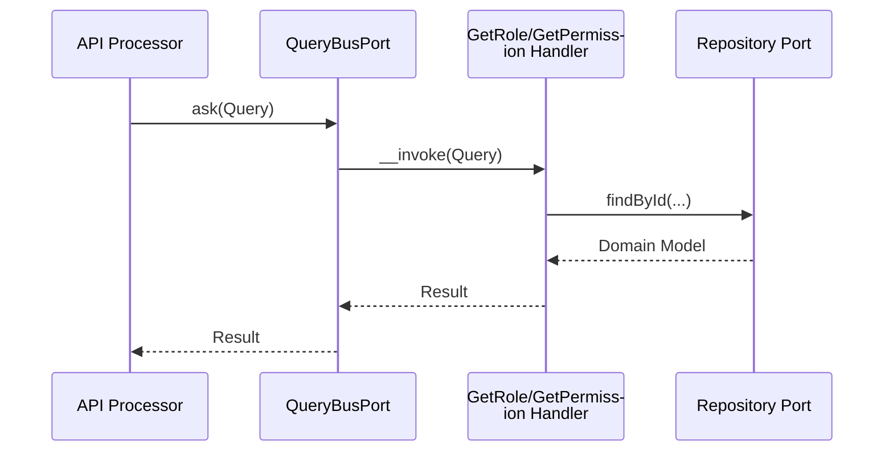
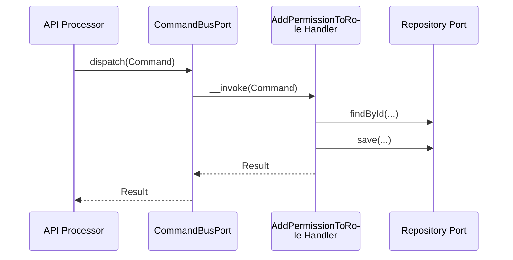

# Authorization Module

**Reading guide:** [Documentation index](../../docs/README.md) · [Related guide](../../docs/guides/organization-and-access.md).

## Overview

Authorization implements RBAC and permission checks for the platform. Roles
group permissions, and role assignments are attached to subjects (users).

## API Endpoints

| Resource   | Method | Path                                             | Description                              |
| ---------- | ------ | ------------------------------------------------ | ---------------------------------------- |
| Role       | GET    | `/api/roles`                                     | List roles                               |
| Role       | GET    | `/api/roles/{id}`                                | Get role details                         |
| Role       | POST   | `/api/roles`                                     | Create role                              |
| Role       | PATCH  | `/api/roles/{id}`                                | Update role                              |
| Role       | DELETE | `/api/roles/{id}`                                | Delete role (system roles are protected) |
| Role       | POST   | `/api/roles/{roleId}/permissions`                | Add permission to role                   |
| Role       | DELETE | `/api/roles/{roleId}/permissions/{permissionId}` | Remove permission from role              |
| Permission | GET    | `/api/permissions`                               | List permissions                         |
| Permission | GET    | `/api/permissions/{id}`                          | Get permission details                   |
| Permission | POST   | `/api/permissions`                               | Create permission                        |
| Permission | PATCH  | `/api/permissions/{id}`                          | Update permission                        |
| Permission | DELETE | `/api/permissions/{id}`                          | Delete permission                        |

## Flows

### Check Permission (Query)

The query translates a permission question into the authorization owner. It returns the effective result without granting a new entitlement.

### Assign Permission to Role (Command)

The command changes the role-permission relationship through its owner. HTTP translation and authorization remain separate from the persistence port.

## Architecture

- Presentation: Api Platform resources, processors, and providers.
- Application: Use cases (Command/Query), ports, and services.
- Domain: Role, Permission, RoleAssignment models with value objects.
- Infrastructure: Doctrine repositories, mappers, fixtures, and voters.

Key folders:

- `src/Authorization/Presentation/Api`
- `src/Authorization/Application/UseCase`
- `src/Authorization/Domain`
- `src/Authorization/Infrastructure`

### Published and private capabilities

Consumers use pure AuthorizationPort and the published Auth authentication-cache invalidation capability. AuthorizationDataLifecyclePort removes scalar user_roles and role assignments before User deletion in the same auth transaction, preserving NO ACTION foreign keys. User seeds compose roles through AuthorizationSeedRoleAssignmentsPort with scalar identities.

Repositories and capabilities exposing owner-local types are private under Application/Port/Outbound/Internal; cross-module access uses published ports and pure contracts.

Authorization publishes pure `PermissionCatalogContributionPort` and
`RoleCatalogContributionPort` contracts. Owners register immutable definitions through
`authorization.permission_catalog_contribution` and
`authorization.role_catalog_contribution`. Composition rejects duplicate keys,
fixture references, conflicting default-role policies and unknown role grants at boot.
Permission publication and bootstrap order are explicit and deterministic.

New permission creation accepts only an exact registered key; a wildcard contribution
does not admit unrelated keys. Registration does not grant access or constrain historical
PermissionName hydration. Custom roles remain ordinary business resources. The optional
registered default-role policy drives account-creation assignment. Authorization fixtures
and permission synchronization consume the composed catalogs; User owns sample-account
role assignments through AuthorizationSeedRoleAssignmentsPort.

## Configuration

Module selection loads [the service entry point](../../config/modules/authorization.yaml)
together with its [owner configuration fragments](../../config/modules/authorization/).
Those fragments contribute owned mappings, API/error metadata and configured
framework/seed registrations. Shared package configuration supplies connections and
manager definitions; this module's persistence remains explicitly wired to `auth`.
See the [composition standard](../../ARCHITECTURE.md#service-wiring).

Module selection loads [the service entry point](../../config/modules/authorization.yaml)
together with its [owner configuration fragments](../../config/modules/authorization/).
Those fragments contribute owned mappings, API/error metadata and configured
framework/seed registrations. Shared package configuration supplies connections and
manager definitions; this module's persistence remains explicitly wired to `auth`.
See the [composition standard](../../ARCHITECTURE.md#service-wiring).

- Service wiring: `config/modules/authorization.yaml`
- Voters: `Authorization\Infrastructure\Security\Voter`
- Fixtures: `Authorization\Infrastructure\DataFixtures\AuthorizationFixtures`
- Permission cache: `AUTHZ_PERMISSION_CACHE_TTL` (seconds). Short TTL is recommended to balance performance and consistency.
- Sync permissions: `php -d memory_limit=1G bin/console app:authz:sync-permissions --update-roles`

## Testing

- Unit: `tests/Unit/Authorization`
- Run module tests: `php -d memory_limit=1G vendor/bin/phpunit tests/Unit/Authorization`

## Error Codes

- `RoleNotFoundException` -> role not found
- `PermissionNotFoundException` -> permission not found
- `SystemRoleDeletionException` -> system role cannot be deleted

`UserGrantSnapshotPort` publishes current scoped role names, registered effective permissions and
active catalog facts from owner-native auth queries. It excludes expired assignments and avoids
shared role caches and managed-record state. Auth uses the snapshot to mint current RBAC claims
and to invalidate encrypted credential replay after role, permission or catalog-policy changes.

Ordinary platform receipts use `FreshAuthorizationPort` to recheck owner assignments, tenant
scope, registered permission metadata and assignment expiration directly in auth. Successful
actual permission/any-role/all-role gates contribute signed request evidence; resource role
or permission targets are checked again before stored result decoding. Creation and mutation
descriptors explicitly select auth rather than relying on a generic database fallback.
The evidence decorator substitutes fresh predicates only for the exact principal verified by
an active idempotency boundary; ordinary untracked calls retain the original owner service.
