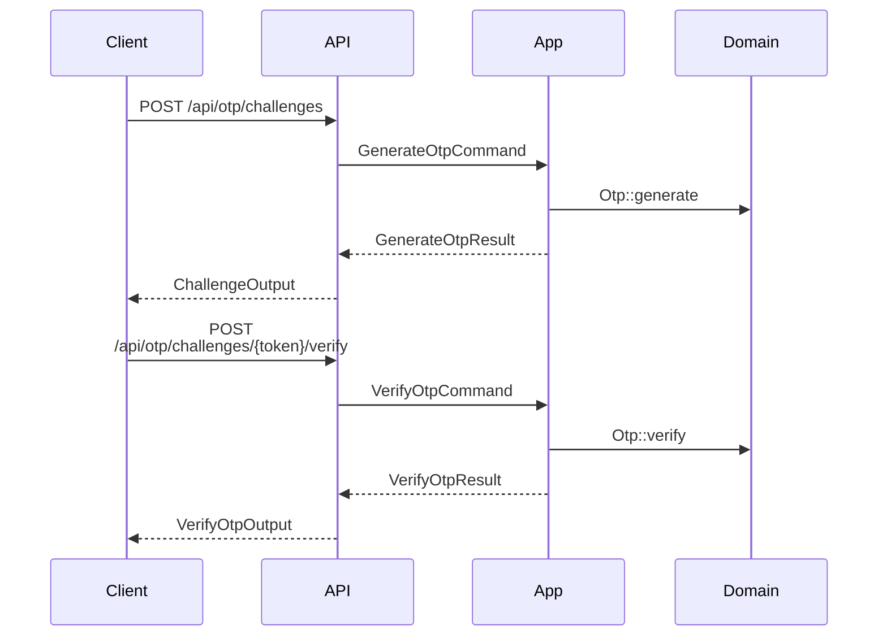
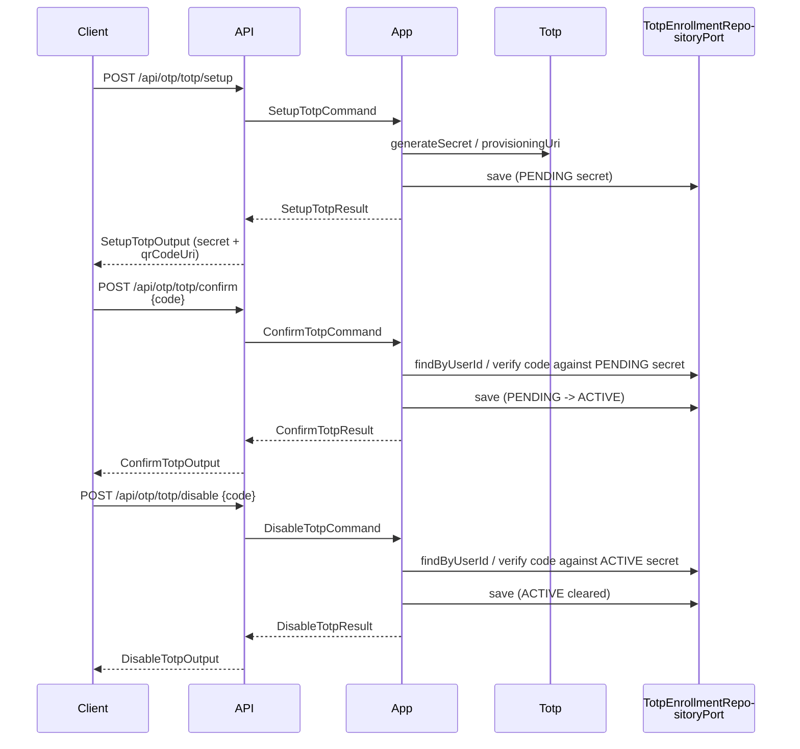

# OTP Module

**Reading guide:** [Documentation index](../../docs/README.md) · [Related guide](../../docs/guides/authentication.md).

## Overview

The OTP module provides challenge-based verification for MFA and other
secure flows. It exposes challenge endpoints only (no direct OTP CRUD
endpoints) and offers a clean inbound port for other modules.

All OTP endpoints are protected by RBAC permissions (`otp_*`) and are
intended for authenticated user flows or internal service usage.

## API Endpoints

| Method | Path                                 | Description                                  | Handler                      |
| ------ | ------------------------------------ | -------------------------------------------- | ---------------------------- |
| POST   | `/api/otp/challenges`                | Create OTP challenge                         | `CreateChallengeProcessor`   |
| GET    | `/api/otp/challenges/{token}`        | Get challenge status                         | `GetChallengeStatusProvider` |
| POST   | `/api/otp/challenges/{token}/verify` | Verify challenge code                        | `VerifyOtpProcessor`         |
| POST   | `/api/otp/challenges/{token}/resend` | Resend challenge code                        | `ResendChallengeProcessor`   |
| GET    | `/api/otp/purposes`                  | List purposes                                | `ListPurposesProvider`       |
| GET    | `/api/otp/channels`                  | List channels                                | `ListChannelsProvider`       |
| POST   | `/api/otp/totp/setup`                | Setup TOTP (generates a PENDING secret)      | `SetupTotpProcessor`         |
| POST   | `/api/otp/totp/confirm`              | Confirm TOTP (activates the PENDING secret)  | `ConfirmTotpProcessor`       |
| POST   | `/api/otp/totp/disable`              | Disable TOTP (requires a valid current code) | `DisableTotpProcessor`       |
| GET    | `/api/otp/totp/recovery-codes`       | Read remaining count and generation time     | `GetRecoveryCodesStatusProvider` |
| POST   | `/api/otp/totp/recovery-codes`       | Replace recovery lot with current TOTP proof | `GenerateRecoveryCodesProcessor` |

`/api/otp/purposes` and `/api/otp/channels` have **no first-party web consumer**
today. They are retained deliberately as public-API discovery affordances for
external integrators driving the OTP challenge flow, on the same reasoning that
keeps `/api/webhooks/event-types` (see `src/Webhook/MODULE.md`) — a client
composing a challenge needs to know which purposes and channels the server will
accept, and hard-coding them into every integration is what a reference catalog
exists to avoid.

This is a **recorded decision, not an oversight**: the check that surfaced it
counted zero consumers under `src/` in the web application, and the answer was
to write the reason down rather than to delete the endpoints.

## Flows

### Email request location

For email challenges only, `GenerateOtpHandler` captures the current request through
`RequestOriginPort` and resolves its IP through `GeoIpLookupPort`. Every generation, including
resends, gets its own typed temporary `EmailRequestDetails`; no location is stored with the OTP.
`OtpNotifierPort` accepts this context and Twig displays geography independently of recognized
browser labels, escaping values and including approximate-location wording and DB-IP attribution.
Outside HTTP the geography is absent. SMS and TOTP never invoke lookup or receive email context.
Origin and lookup failures are isolated from delivery. If origin extraction fails, no IP lookup
is attempted; if lookup fails, known device labels and locale remain. Email delivery always
receives an explicit context object, even empty, and notifier failures still propagate.

### Challenge (Email/SMS)

Resend cooldowns and HTTP rate limits expose `rate_limit_exceeded` and
`retryAfterSeconds` through the shared Problem Details boundary, including Auth's
registration, password-reset and MFA resend endpoints. `Retry-After` remains available.

### TOTP Setup / Confirm / Disable

TOTP enrollment stages a secret, verifies possession and changes the enrollment state. Setup, confirmation and disable retain their separate authorization/OTP requirements.

TOTP enrollment state is stored server-side per user (`totp_enrollments`, auth
database) with an optional ACTIVE (confirmed) secret and an optional PENDING
(unconfirmed) secret, tracked independently. Re-calling setup replaces
the PENDING secret only during initial enrollment. Setup and confirmation refuse
an ACTIVE factor with HTTP 409, including legacy rows containing both secret slots.
Replacing an active authenticator requires the existing protected disable operation
with its current code, followed by setup and confirmation. This intentionally offers
no simultaneous active-factor rotation without a separate step-up proof. The first-party
account interface already exposes this disable-then-enroll flow.

Setup, confirmation and disable hold one per-user auth transaction lock around a fresh
enrollment read, code verification and state persistence. Fresh row reads also take a
pessimistic lock within that transaction. Concurrent initial setup/confirmation cannot
replace a factor activated by an earlier request. Successful events follow commit. The client never supplies the secret back to
the server for confirm/disable — only the current authenticator code.

### Authenticator recovery

Recovery generation requires an active account, an active authenticator and its current TOTP
code. It returns ten independently generated 128-bit codes, grouped into eight hexadecimal
blocks of four characters. Generation replaces every previous code atomically. The enrollment
persists only SHA-256 digests and a generation timestamp; GET exposes only `remainingCount`
and `generatedAt`, never proofs or digests. Codes accept compact or formatted hexadecimal
representations without changing their entropy.

Auth MFA completion accepts `method: otp|recovery_code` (default `otp`) with the existing
`code` and `preAuthToken` fields. The published `MfaChallengeVerificationPort` binds the
verified token's owner and LOGIN purpose before challenge locking. It holds the per-user
enrollment lock, then a fresh owner-filtered challenge write lock, and commits both recovery
code consumption and challenge consumption on the auth connection. Wrong proofs persist
challenge attempts. Expired, exhausted, consumed, wrong-owner and wrong-purpose challenges,
inactive accounts and inactive enrollments cannot consume recovery proofs.

Login proof verification rereads User's published `SignInEligibilityPort` under the auth lock
with the current `AuthenticationPolicyPort` email-verification choice. A pending-verification
account may complete email MFA only when that choice is waived; locked, inactive, missing and
unknown account states always deny. Authenticator management and recovery metadata/generation
retain their active-account requirement independently of the sign-in policy.

Disable accepts `proofType: totp|recovery_code` (default `totp`). A recovery code already used
for login cannot disable the authenticator; a different unconsumed code is required. Successful
disable erases both secret slots, all remaining recovery digests and their generation timestamp.
Failed disable proofs retain the existing durable cooldown and per-user HTTP rate limit.

Recovery generation and successful consumption enqueue safe owner facts on the auth outbox
after enrollment/challenge persistence, inside the same transaction. Rollback leaves no recovery
fact for delivery. Audit records `otp.recovery_codes_generated` with count, date and replacement
flag, and `otp.recovery_code_consumed` with purpose (`login` or `totp_disable`). Neither event
contains codes, digests or authenticator material. Successful setup, confirmation, disable and
lot replacement increment the User security revision in that transaction; consuming a recovery
login code alone does not change that revision.

### Mailbox possession

The `email_ownership` purpose is separate from registration and sensitive operations.
`EmailOwnershipChallengePort` verifies the account, purpose and current recipient under
an explicit auth transaction with a pessimistic row lock. Failed attempts are committed;
success consumes the code once. The bound recipient is checked before code consumption,
so codes sent to an old address cannot prove the current address. Both email and external
verification reject an already-consumed challenge. No proof is granted by the generic
OTP HTTP endpoints; Auth must confirm it through the User capability.

## Architecture

- Hexagonal module with strict layer boundaries.
- Inbound ports: `Otp\Application\Port\Inbound\Challenge\OtpChallengePort`, `Otp\Application\Port\Inbound\Totp\TotpStatusPort` (used by the User module for `/api/me` and, via a small adapter, by the Auth module for login MFA channel selection). A technical lookup/decryption failure propagates and blocks sign-in; it does not select email as a fallback factor.
- Outbound ports: `Otp\Application\Port\Outbound\Challenge\OtpRepositoryPort`, `Otp\Application\Port\Outbound\Challenge\OtpNotifierPort`, `Otp\Application\Port\Outbound\Totp\TotpServicePort`, `Otp\Application\Port\Outbound\Totp\TotpEnrollmentRepositoryPort`.
- Cross-module contracts are defined in `Otp\Application\Contract`.
- `TotpEnrollmentPurgePort` removes all active/pending plaintext and ciphertext slots plus enrollment/lockout state on account deletion, on the auth connection only.
- Cross-module adapter: `Otp\Infrastructure\Adapter\Auth\TotpEnrollmentCheckAdapter` implements `Auth\Application\Port\Outbound\Mfa\TotpEnrollmentCheckPort` (Auth-owned port), delegating to `TotpStatusPort`.
- `Otp\Application\UseCase\Command\Challenge\VerifyOtp\VerifyOtpHandler` checks the OTP's channel: for `totp`, the submitted code is verified against the user's ACTIVE TOTP secret (via `TotpEnrollmentRepositoryPort` + `TotpServicePort`) instead of the challenge's own random code; challenge-level expiry/attempt bookkeeping is unchanged (`Otp::verifyExternal()`).

### Published and private capabilities

ChallengeAccessPort exposes immutable challenge projections and resend timing without a mutable aggregate. Auth confirmations use OtpChallengePort::verifyFor for purpose/owner binding and persisted attempts. The resend cooldown remains 60 seconds.

OtpDataLifecyclePort owns challenge purge/retention; enrollment erasure continues through the existing locked enrollment purge capability.

Repositories and capabilities exposing owner-local types are private under Application/Port/Outbound/Internal; cross-module access uses published ports and pure contracts.

Otp publishes its global permission vocabulary through Authorization's pure
`PermissionCatalogContributionPort`. Its owner-local
`OtpPermissionContributionAdapter` is registered with
`authorization.permission_catalog_contribution`; composition rejects duplicate keys
at boot and preserves explicit publication order. This contribution defines available
permission keys and does not grant them to a subject.

## Configuration

Email enrichment uses Shared's GeoIP switch and local database. It is disabled by default
and never creates a persistent geography history in Notification, audit or realtime events.

- Services: `config/modules/otp.yaml`.
- Recovery generation limiter: `otp_totp_recovery_codes`, five requests per minute per owner.
- Notification sender: `MAILER_FROM` (used by `OtpNotifierAdapter`).
- Email template: `templates/otp/email/code.html.twig` (rendered by Twig in `OtpNotifierAdapter`).
- **Request details in the code email.** Next to the code, the email shows the date and time (UTC,
  from `Otp::createdAt()`), the browser and the operating system of the request that asked for it, so the
  recipient can tell their own sign-in from someone else's.
  `RequestOriginPort` supplies parsed browser and OS labels from the main HTTP request. Only fixed
  labels reach the template, never the raw `User-Agent`; an unrecognised field is omitted.
  `GenerateOtpHandler` resolves the request IP through Shared's local GeoIP port and passes the
  country and optional city in temporary `EmailRequestDetails`, independently of browser recognition.
  The location block includes approximate-location wording and DB-IP attribution when available.
  Disabled enrichment, a missing database, private IPs and non-HTTP requests leave it absent.
- OTP code length: `OTP_CODE_LENGTH` (applies to challenge OTPs like SMS/email).
- TOTP code length: `TOTP_DIGITS` (applies to authenticator app codes). Changing this will invalidate existing TOTP enrollments.
- TOTP confirmation max attempts: fixed at 5 (`SetupTotpHandler::DEFAULT_MAX_ATTEMPTS`), reset each time setup is called again.
- Rate limits (`config/packages/rate_limiter.yaml`): `otp_totp_confirm`, `otp_totp_disable` (5/minute per user, mirrors `otp_challenge_verify`).
- **Disable has a second, persistent brake.** The rate limiter throttles bursts
  but resets every minute, so on its own it left the disable endpoint an
  unbounded oracle: 7 200 guesses a day against a six-digit code. After
  `TotpEnrollment::MAX_DISABLE_ATTEMPTS` (5) wrong codes the enrollment freezes
  for `DISABLE_LOCK_DURATION` (15 minutes), stored on the row
  (`disable_attempts`, `disable_locked_until`) so it survives across requests
  and processes. That is ~480 attempts a day instead of 7 200.

  Two properties are deliberate and should not be "simplified" away:

  - **The freeze refuses the correct code too.** Letting a valid code through
    would leave the freeze no obstacle to the only caller it exists for — the
    one who eventually guesses right.
  - **The freeze is temporary, unlike `confirmPending()`'s permanent lock.**
    Confirmation guards a _pending_ secret, and its lock is escaped by
    restarting enrollment. Disabling guards the _active_ secret: a permanent
    lock would leave the user unable to turn TOTP off **and** unable to
    re-enroll around it — a dead end only support could open.

  The counter is separate from `attempts`, which belongs to confirmation. One
  shared counter would let a failed disable eat the enrollment's confirmation
  budget, and the two reset on different events.

- Permissions: `otp_totp.setup`, `otp_totp.confirm`, `otp_totp.disable` (see `Authorization\Infrastructure\Catalog\PermissionCatalog`); granted to the default `user` and `admin` roles.
- Secret storage uses the Otp-owned `TotpSecretCipherPort`, implemented by
  AES-256-GCM with a dedicated key ring. Versioned envelopes carry the key identifier;
  their authentication binds the user and active/pending slot. New writes are encrypted
  once `TOTP_ENCRYPTION_WRITE_KEY` is provisioned. Legacy rows remain readable during
  rollout. The durable `secrets_encrypted` marker prevents writes from reverting a
  migrated enrollment to plaintext if configuration is rolled back. Decryption failure
  never falls back to plaintext. Authenticator secrets and enrollment/lockout state stay
  unchanged.

### Encryption deployment and key rotation

1. Apply additive auth migration `Version20260920150000` before the compatible reader.
   It keeps both old columns and adds encrypted active/pending columns plus the marker.
2. Provision `TOTP_ENCRYPTION_KEYS` through the deployment secret store: a JSON object
   mapping key IDs to base64-encoded, randomly generated 32-byte keys, dedicated to Otp.
   Keep `TOTP_ENCRYPTION_WRITE_KEY` empty only during the initial compatible-read rollout.
3. Once every instance can read ciphertext, select the write-key ID. New and updated
   enrollments now use encrypted storage and clear their old values.
4. Run `php -d memory_limit=1G bin/console app:otp:encrypt-secrets --batch-size=100`.
   Each auth transaction locks a bounded batch, authenticates old ciphertext, migrates
   or rotates secrets, verifies the decrypted result, and then commits. Restarting is
   safe; current envelopes are not rewritten. No account IDs or secrets are printed.
5. Run the same command with `--verify-only`; it writes nothing and fails if any row
   still needs migration or if a key/envelope is invalid. Retain the old columns until
   deployment and data verification are complete; remove them only in a later migration.
6. For rotation, add a new key while retaining prior keys, select its ID for writes,
   rerun migration and verification, then retire old keys only after verification and
   the backup/rollback retention window. Backups containing older envelopes need their
   corresponding keys. A rollback must retain this compatible reader and the key ring.
   Schema rollback is explicitly refused once any enrollment has been encrypted.

### Account deletion and enrollment serialization

Setup reads the published User account status from auth storage after taking the per-user
TOTP transaction lock. A principal authenticated before a completed account deletion cannot
create a new pending secret. User deletion acquires this same lock before removing the account,
and holds the auth transaction through deletion of all linked auth data, including every TOTP
secret slot. Setup that commits first is included in the subsequent purge; deletion that commits
first makes the resumed setup fail with a neutral 403. Purge failures roll back account removal.
No main-database transaction or TOTP foreign-key migration is involved.

## Testing

Tests exercise fresh resend origins, unknown browsers, non-HTTP invocation, SMS/TOTP exclusion,
real Twig escaping and the en/fr/es geography catalogs. A location-bearing delivery failure
still fails the caller but exposes only a fixed message and the exception type, without
chaining provider details into application logs.

- Unit: `tests/Unit/Otp` (handlers, domain, adapters).
- Functional: `tests/Functional/Api/OtpTotpApiTest.php`.
- Recovery: `tests/Functional/Api/MfaRecoveryCodesApiTest.php` and the two-connection
  `tests/Integration/Otp/MfaRecoveryConsumptionConcurrencyTest.php` verify delivery, one-time
  consumption, safe metadata and independent proof for disable.
- E2E: `tests/E2E/OtpChallengeFlowTest.php`, `tests/E2E/OtpConfigFlowTest.php`, `tests/E2E/TotpFlowTest.php`.

## Error Codes

- `404 Not Found`: challenge token not found; no pending TOTP setup for confirm; TOTP not enabled for disable.
- `422 Unprocessable Entity`: invalid/expired TOTP code on confirm or disable.
- `422 Unprocessable Entity`: recovery generation rejects an invalid current authenticator code.
- `404 Not Found`: recovery generation requires an active authenticator enrollment.
- `429 Too Many Requests`: resend cooldown not elapsed; TOTP confirm/disable rate limit exceeded; **TOTP disable frozen after 5 wrong codes** (`Retry-After` carries the remaining seconds).
- `409 Conflict`: setup or confirmation attempted while TOTP is already active; disable with the current factor first.
- `403 Forbidden`: setup refuses a missing or non-active account using a fresh auth-side status check inside the enrollment mutation lock.
- `400 Bad Request`: invalid input or unauthenticated user where required.

## Challenge and factor HTTP receipts

Otp contributes explicit auth ownership for challenge create/resend/verify and TOTP
setup/confirm/disable/recovery generation. Current authenticated account state, scoped platform
grants, exact challenge owner/purpose/channel/recipient and credential revision are checked live
before an encrypted result is decoded. Generic HTTP challenge creation and resend use the stable
account ID rather than its email login identifier. Resend rejects another account's challenge.
Bound verification locks the matching account/purpose row inside an auth transaction before
consumption; failed verification and its receipt commit the same attempt count.

TOTP mutations own a final auth root transaction around the existing per-user lock. The business
mutation, security revision, intentional failure counter and receipt are committed together.
Compatibility enrollment events run after that final commit. Auth-bound recovery facts remain in
the same transaction. The signed receipt records both the original and committed revision plus
non-secret current factor timestamps/counters. Exact replay of recovery generation or disable
therefore does not verify an expired TOTP again or consume a recovery code twice. A later factor
change, credential revocation or grant removal denies replay; secret results expire after five
minutes without renewing their deadline.

External email/SMS delivery is fenced immediately before the provider call. A rollback after
potential delivery leaves the receipt unavailable for automatic retry, preventing a duplicate code
message after an uncertain provider outcome. Completed receipts reuse the original result and do
not invoke delivery again. `ChallengeLifecycleProofPort` publishes fresh non-secret ownership and
consumption facts from auth storage; no code digest, factor secret or bearer token is published.