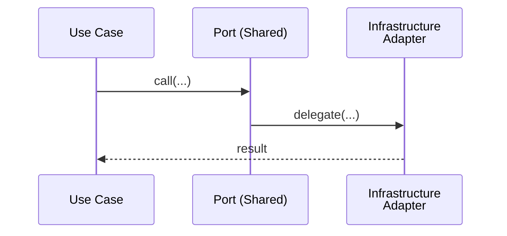
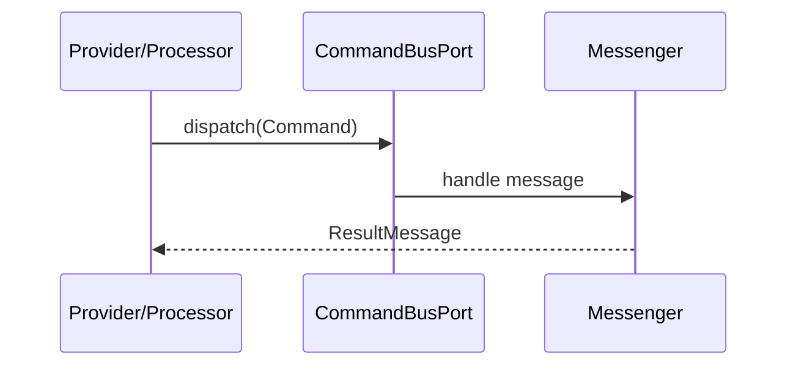

# Shared Module

**Reading guide:** [Documentation index](../../docs/README.md) · [Related guide](../../docs/guides/module-development.md).

## Overview

Shared is the repo-wide kernel. It provides stable contracts, base value objects,
ports, and infrastructure adapters used across all modules. It also exposes the
health check endpoint.

## API Endpoints

| Method | Endpoint      | Description              | Auth |
| ------ | ------------- | ------------------------ | ---- |
| GET    | `/api/health` | Application health check | No   |

### Health Check Response

```json
{
  "status": "healthy|degraded|unhealthy",
  "timestamp": "2024-01-01T12:00:00+00:00",
  "database": true,
  "cache": true,
  "version": "1.0.0"
}
```

**Status values:**

- `healthy`: All dependencies are operational
- `degraded`: Non-critical dependency failure (cache)
- `unhealthy`: Critical dependency failure (database)

## Flows

### Optional local GeoIP

`GeoIpLookupPort` resolves public IPv4/IPv6 addresses against DB-IP City Lite MMDB locally.
It returns immutable `IpLocation(countryCode, city)` or null. Disabled collection, invalid or
reserved addresses, missing/corrupt/stale files and unknown records never prevent security flows.
The reader opens and closes per call, including long-lived FrankenPHP workers; no IP is sent to DB-IP.
`RequestOriginPort` publishes trusted `getClientIp()`, fixed browser/OS labels and locale from the
main HTTP request, or null outside HTTP. `EmailRequestDetails` omits the IP and is delivery-only.
Both HTTP origin adapters trim and bound the User-Agent to 512 bytes; unknown values, including
`0`, preserve the trusted IP and locale without inventing browser or operating-system labels.
Security email handlers treat origin and geography as independent optional enrichments: an
unavailable port leaves partial or empty delivery context and cannot prevent the email send.

`app:geoip:update` selects the UTC monthly official HTTPS archive, uses a shared-volume lock,
streams bounded bytes, validates gzip integrity and MMDB metadata/search, and replaces atomically.
Failed download/validation retains the installed file. `--check` reports validity/freshness;
`--if-enabled` skips scheduled work while disabled. Operational output contains no lookup data.


### Outbound Port -> Adapter

`SpreadsheetSafeTextPort` protects formula prefixes, leading control/space text and
literal apostrophes in spreadsheet-facing CSV. A versioned `_fireguard_text_encoding`
column permits the Import parser to restore original text only for explicitly marked
rows; unmarked files retain their historical literal values and trimming rules.
Typed numeric columns bypass text protection. Marked CSV uses RFC4180 quote escaping.

`ImageInputValidationPort` checks compressed bytes (5 MiB), native header dimensions
(4096 pixels per axis) and the total input budget (4,194,304 pixels) before GD decodes
avatars or organization logos. GIF preflight also checks the first image descriptor
and its containment within the logical screen, independently of GD's version.
Their image manager disables animation decoding and
uses only the native first frame. Invalid headers and over-budget input return 422.

Application code invokes a contract; an infrastructure adapter implements the external operation. Dependency ownership stays inward even when runtime calls go outward.



### Inbound Bus Port

The inbound bus port routes a command/query to its application handler. The transport adapter does not become the owner of the business decision.



## Architecture

Doctrine schema generation retains foreign keys for scalar module identifiers through
`ScalarForeignKeySchemaListener`, registered separately on `auth` and `main`. Main-side
organization identifiers preserve `ON DELETE CASCADE`; Authorization's scalar `user_roles`
membership preserves its composite key and `NO ACTION` foreign keys. Descriptors only act
when both tables exist in the owning manager's schema, so no key crosses databases.

HTTP 429 responses publish `code: rate_limit_exceeded` and nullable integer
`retryAfterSeconds`, retaining the standard `Retry-After` header. Clients must not
parse human-readable error copy to decide when to retry. Unknown deadlines remain
null. The exception boundary also handles wrapped command failures.

HTTP parameter declarations use API Platform 5 `QueryParameter` and
`HeaderParameter`. `OperationParameterReader` reads the framework-parsed values
for custom providers/processors, retaining undeclared legacy query keys and
bracketed arrays without mutating the request. Existing operations explicitly
retain their provider validation, defaults and conditional-request status codes
(`constraints: []`, no automatic casting). This compatibility boundary prevents
schema-only documentation from changing historical pagination clamping, OAuth
protocol errors or 412/428 responses. New operations declare native constraints
and enable strict query validation. Migrate legacy validation only with endpoint
contract tests covering its current error and access-order semantics.

- Application: message types, ports, contracts (pagination), factories, and shared exceptions.
- Domain: value objects, domain events, traits, and domain services.
- `Uuid::assertValid` provides the constructor's identifier validation without allocating an object; validation-only callers retain their original string and the same invalid-value error.
- Infrastructure: Symfony adapters, serializer normalizer, event dispatcher/listener,
  and infrastructure exceptions.

Pure parsing, revision and merge-patch behavior belongs to the published
`Application/Contract/Http` contracts. Module-local operation readers expose only
their used channels and retain framework `ParameterNotFound`, parameter-bag copies
and HTTP 400 handling. `ParsedQueryParameters` and `ParsedHeaderValue` own nesting
and value validation; `MergePatchDocument` and `RevisionPrecondition` own mutation
parsing. Request-stack access and HTTP 428/412 translation remain with the HTTP
facades in their owning modules.
Seed timeline and identifier helpers likewise have one pure implementation under
`Application/Contract/Seed`; composition does not expose technical fixture helpers.

Key folders:

- `src/Shared/Application/Contract`
- `src/Shared/Application/Message`
- `src/Shared/Application/Port`
- `src/Shared/Domain/ValueObject`
- `src/Shared/Infrastructure/Symfony/Adapter`

## Configuration

### Durable HTTP idempotency

An explicitly opted-in write operation reserves its client key only after current authentication,
tenant context, permissions and resource scope have been verified. The scope binds the verified
principal, tenant, organization when present, operation identity and canonical resource URI.
Global identifier routes may use principal/tenant/operation/URI scope and retain the original
organization in authenticated non-secret result proof. Meaningful request query data, input and
original preconditions belong to the canonical HMAC fingerprint. Neither raw keys nor credentials
or request inputs are persisted.

Each database owns its independent `http_idempotency_receipts` table and engine. A reservation
commits on a separate physical connection to that same database before business writes.
Unused pending reservations expire after 60 seconds and can change owner under a row lock;
an earlier owner is fenced before any mutation. Once the owning write transaction starts,
the engine durably marks the reservation as writing and locks its receipt on the primary
connection. It stores the versioned application result before that transaction commits.
Fresh owner-organization evidence supplied at claim also indexes incomplete global-URI attempts
for permanent organization purge, including after a confirmed rollback.
The business mutation, outbox work and result snapshot therefore share one owning commit.
No HTTP transaction encloses root-owned media writes and no transaction spans auth and main.

Replays return the originally committed application result for 24 hours. Secret-bearing results
use a five-minute window measured from the first completion; retries never renew either deadline.
Current authentication and authorization must be revalidated for every replay. `inspectProof`
authenticates non-secret identifiers, revisions and scope metadata before result bytes are opened.
Its HMAC binds the canonical proof, scoped receipt, original fingerprint and absolute deadline.
Encrypted result AAD also binds that deadline and proof MAC. Proof never contains raw tokens.
The engine also submits the authenticated proof of the receipt actually selected for replay
to the current owner gate before opening bytes or acknowledging expiry. A completion between
initial inspection and reservation therefore uses the original committed proof, including
during uncertain-commit reconciliation, without repeating credential attempts or mutations.
An altered fingerprint, an in-flight write, an elapsed replay window or an uncertain outcome
denies execution. Only confirmed root rollback releases the current owner's reservation.
Rollback retains the original fingerprint and expires its ownership, allowing an identical
retry to take over while continuing to reject changed input on the same key.
An unknown commit can reconcile a visible completed result; incomplete writing or unknown
receipts remain blocked and never permit automatic takeover.

Configure `HTTP_IDEMPOTENCY_HMAC_KEY` as a dedicated random base64 HMAC key of at least 32 decoded
bytes. `HTTP_IDEMPOTENCY_ENCRYPTION_KEYS` is a JSON object of version names to dedicated base64
AES-256 keys; `HTTP_IDEMPOTENCY_ENCRYPTION_ACTIVE_VERSION` selects the writing version.
Keep earlier versions available through the secret replay window during rotation. These keys
are separate from application, OAuth and JWT keys. Missing or invalid keys fail closed.
The HMAC addressing key must remain stable while any retained scope can retry; changing it
without preserving lookup of the earlier key would bypass its receipt and tombstone identities.
Main is the ordinary default engine; auth operations must receive the explicit auth engine.

Run `app:cleanup:http-idempotency-results` every minute to erase elapsed replay bytes on each
database independently. It retains durable non-reusable tombstones beyond the 24-hour result
window, protecting offline retries. Permanently deleted accounts and organizations must call
`purgePrincipal` and `purgeOrganization` on both explicitly owned engines after confirmed deletion;
these indexed digests remove every operation/URI receipt for that lifecycle. Account deletion
also removes client-scoped and federated receipts whose finalized owner-verified proof names
that account in `user_id`, including after encrypted result bytes have expired. Narrow
`purgeScope` is available for a definitively removed operation scope.

Pure unit tests cover canonical HMACs, AES-GCM rotation/tampering, proof and deadline authentication,
replay expiry and transaction boundary denials. PostgreSQL integration tests use independent physical
connections on both databases to cover atomic snapshots, lease takeover and stale-owner fencing,
confirmed rollback, unknown commits, offline tombstones and secret expiration.

GeoIP defaults live in `config/packages/geoip.yaml`: `GEOIP_ENABLED=false`,
`GEOIP_DATABASE_PATH=%kernel.project_dir%/var/geoip/dbip-city-lite.mmdb`, `GEOIP_MAX_AGE_DAYS=45`.
`TRUSTED_PROXIES` is an explicit comma-separated IP/CIDR allowlist, empty by default. Only
forwarded-for/proto/port headers are trusted from those proxies. Aliases and adapter arguments
are in `config/modules/shared.yaml`. Symfony HttpClient/Lock and `maxmind-db/reader` are used
without a bundle. Production mounts the database read-only in the app and writable in maintenance.
Local Compose forwards `GEOIP_ENABLED` to the app and both workers; recreate these services
after changing the flag. The local database is retained in the persistent `app_var` volume.
See [GeoIP operations and privacy](../../docs/guides/geoip-operations-and-privacy.md) before activation.


### Durable events and local consumer receipts

`TransactionalEventDispatcher` writes a stable event envelope to the Doctrine
`main_outbox` transport using the same `main` connection as its producer. The
explicit auth dispatcher uses `auth_outbox` and the auth connection. Both refuse
calls outside an active transaction. Publication requests/completions,
non-conformity automation triggers and automation outcomes use this boundary.
Delivery is at least once; workers set a scoped `DurableEventContextPort` identity
and clear it in `finally`, including failures and nested deliveries.

`IdempotentConsumerPort` inserts its receipt and performs local writes in the same
transaction. Its main and auth adapters are explicitly wired: notifications and
automation dispatch receipts live in main, audit receipts in auth. An auth commit
is independent of later main failures, so retries skip already committed audit
work. No transaction or foreign key spans the two databases. Equipment service
history retains its existing per-change deduplication; webhooks reuse the durable
event ID across fan-out retries. Durable subscriber failures propagate to Messenger.

Messenger owns `messenger_messages`, excluded from ORM schema introspection in
both databases. Deploy the additive receipt migrations and initialize each
transport before consumers, including on a fresh installation:

```sh
for transport in main_outbox auth_outbox main_failed async webhook assistant failed; do
  php -d memory_limit=1G bin/console messenger:setup-transports "$transport" --env=prod --no-interaction || exit 1
done
```

`main_outbox` and `webhook` failures go to `main_failed`; `auth_outbox` and other
asynchronous work use the historical auth `failed` queue. The ordinary async
worker consumes both outboxes. Never prune receipts while retained messages may replay.
External delivery remains at least once where a provider has no idempotency key.

Consumer health observes a per-container receiver-loop heartbeat, including idle
polls, instead of PID liveness alone. Successful known sweep messages update only
their bounded persistent completion timestamps. `app:workers:queues` observes both
explicit auth/main connections for overdue due work and failed queues, without
reading payloads. Deploy every dedicated consumer and all six scheduler receivers;
run transport initialization before startup. See the worker operations guide for
freshness thresholds and coordinated writer shutdown.

- Service wiring: `config/modules/shared.yaml`
- Parameters: `config/services.yaml` (e.g., `shared.file_storage.base_path`)

`app:fixtures:append <group>` is a dev/test-only, main-database command for opt-in
demo data. Only repeatable fixtures explicitly tagged `app.seed_fixture.append`
are eligible. It runs the selected set in one transaction, never purges data,
never writes auth, and never auto-loads prerequisite fixtures. Unknown groups
fail before database access. The existing `app:fixtures:load` purge/reload
contract is unchanged.

## Object Storage (FileStoragePort backend)

`Shared\Application\Port\Outbound\FileStoragePort` (`write`/`read`/`delete`/`exists`)
is byte-identical to before; only its bound adapter changed. All four current
consumers are untouched: `Equipment` attachment add/delete, `User`
`GetUserAvatarProvider`/`AvatarResizer`, and `Organization`
`GetOrganizationLogoProvider`/`OrganizationLogoResizer`.

- **Adapter**: `Shared\Infrastructure\Symfony\Adapter\Outbound\FlysystemFileStorageAdapter`
  wraps a `League\Flysystem\FilesystemOperator`. Every
  `League\Flysystem\FilesystemException` is caught and re-thrown as the
  public `Shared\Application\Contract\Storage\FileStorageException`
  (`readFailed`/`writeFailed`/`deleteFailed`), so the write-then-persist
  rollback contract used by handlers (e.g. Equipment's `AddAttachmentHandler`)
  is unchanged. `delete()` stays idempotent (no error on a missing key),
  matching the legacy local-disk adapter — both the Flysystem local adapter
  and the S3 adapter are idempotent on delete by design.
- **Factory**: `Shared\Infrastructure\Storage\FlysystemFactory::create(string $dsn): FilesystemOperator`
  parses the env-driven `STORAGE_DSN` and builds the matching Flysystem
  operator. Two schemes:
  - `local://<path>` — `League\Flysystem\Local\LocalFilesystemAdapter`. A
    relative path resolves against `%kernel.project_dir%` (injected into the
    factory as `$projectDir`); an absolute path (`/abs/...` or `C:\abs\...`)
    is used as-is. The documented default, `local://var/storage`, resolves to
    the exact directory the legacy `FileStorageAdapter` used
    (`shared.file_storage.base_path` = `%kernel.project_dir%/var/storage`),
    so existing keys (equipment attachments, avatar variants, org logos)
    resolve unchanged — **path-compatible, no data migration needed**.
  - `s3://<accessKeyId>:<secretAccessKey>@<bucket>?region=<region>[&endpoint=<url-encoded-endpoint>&use_path_style_endpoint=1]`
    — `League\Flysystem\AsyncAwsS3\AsyncAwsS3Adapter` backed by
    `AsyncAws\S3\S3Client` (async-aws, not the full `aws-sdk-php`, for a
    lighter footprint under FrankenPHP). `endpoint` and
    `use_path_style_endpoint` are optional and needed for MinIO/non-AWS S3.
  - Any other scheme, or a DSN missing a required component (bucket,
    credentials, region for `s3://`; a non-empty path for `local://`), throws
    `InvalidArgumentException`.
- **Wiring** (`config/modules/shared.yaml`): `shared.flysystem.default` is a
  factory service built by `FlysystemFactory::create('%env(STORAGE_DSN)%')`;
  `FlysystemFileStorageAdapter` receives it as `$filesystem`; `FileStoragePort`
  is aliased to `FlysystemFileStorageAdapter`. The legacy
  `Shared\Infrastructure\Symfony\Adapter\Outbound\FileStorageAdapter` class
  stays registered (unbound) as a documented fallback/reference.
- **Env**: `.env` / `.env.test` default to `STORAGE_DSN=local://var/storage`
  (hermetic, no external dependency for dev/test/CI). Production points
  `STORAGE_DSN` at `s3://...` for S3/MinIO — see `OPERATIONS.md`.
- **Migration note**: because storage keys are unchanged and relative, moving
  an existing deployment from local disk to S3/MinIO is a one-time bulk copy
  of `var/storage/**` to the bucket at identical keys (e.g. `aws s3 sync` or
  `mc mirror`) — no `storagePath` column changes, no schema migration. See
  `OPERATIONS.md` for the runbook.

## Attachment Kernel (R11b — generalized per-module attachments)

`AttachmentDownloadPort` publishes a framework-independent `AttachmentDownload` containing
authorized bytes and download headers. Module-owned responders create their HTTP response
from this contract. The shared adapter keeps the existing attachment disposition, Unicode
filename fallback, MIME fallback, byte length, `nosniff` and private no-store policy in one place.

Media commands that couple bytes to SQL use `RootTransactionManagerPort` on their
explicit owning connection: main for attachments and signatures, auth for avatars.
They call `assertCanStart()` before writing bytes and
own their final commit. An enclosing transaction is rejected before the operation;
a savepoint cannot confirm durability. Operation failures propagate after confirmed
rollback, while `CommitOutcomeUnknownException` signals failed commit or rollback
confirmation and prohibits blind file compensation.

Each upload attempt owns a distinct key. SQL mutations request obsolete-key deletion
through `FileCleanupPort` inside their owning transaction. The strict transactional
dispatcher records `FileCleanupRequested` in the outbox on that same connection.
The storage consumer runs after commit, requires a durable delivery identity and
records a receipt on the event's owning database only after an idempotent deletion
succeeds. Main remains the default for legacy envelopes without a database field.
The explicit auth cleanup service records auth ownership and receives its independent
auth receipt adapter. Failed storage deletion rolls back only that receipt and follows
the transport's bounded retry and failure policy. Replacement signatures and avatars
use the same durable cleanup path; no transaction spans auth and main.
Rollback preserves the existing bytes, and no request can delete another upload
attempt's winning key. Historical global orphan collection remains a separate flow.

A thin, **persistence-free** kernel shared by every module's own attachment
slice (Inspection, Intervention, Facility — and optionally Equipment). It is
the single source of truth for the MIME-type/size policy and the storage-path
scheme; it owns no Doctrine entity manager mapping and no table. Each module
still owns its own attachment aggregate, table, repository, use cases and
endpoint end-to-end (see the module's own `MODULE.md`).

- **`Shared\Domain\Attachment\AttachmentCategory`** (enum `IMAGE`|`DOCUMENT`):
  maps a category to its allowed MIME types
  (`image/jpeg`, `image/png`, `image/webp`, `image/gif` for `IMAGE`;
  `application/pdf` for `DOCUMENT`).
- **`Shared\Domain\Attachment\AttachmentConstraints`**: `MAX_SIZE_BYTES` (10 MB)
  and `validate(string $mimeType, int $size): void`, throwing
  `InvalidAttachmentException` (reason `size` or `mime`) on violation. This is
  the only place the MIME/size allow-list is defined — no module keeps its own
  copy. It also owns `MAX_ATTACHMENTS_PER_PARENT` (**25**) and
  `validateCount(int $currentCount): void` (reason `count`): the per-parent
  cardinality cap, enforced by every module's `Add…Attachment` **handler**,
  because the count is a rule over persisted state that the request-scoped
  guard cannot see. One constant for all modules, on purpose — a per-module
  number would drift.
- **`Shared\Domain\Attachment\InvalidAttachmentException`**: `forMimeType()` /
  `forSize()` / `forCount()` factories; `reason(): string` distinguishes the
  three cases for callers that want to branch on it.
- **`Shared\Domain\Attachment\StoragePathScheme::build(module, parentId, attachmentId, fileName): string`**:
  deterministic, path-traversal-safe key
  `{module}/{parentId}/attachments/{attachmentId}_{sanitizedFileName}`
  (`basename()` strips any directory component from the untrusted file name).
  Same shape as the equipment attachment path (`equipment/{id}/attachments/...`),
  so every module's attachments coexist under one storage root/bucket.
- **`Shared\Presentation\Api\Attachment\UploadedAttachment`**: presentation
  read model (`fileName`, `contents`, `mimeType`, `size`, `?label`) produced by
  the guard below.
- **`Shared\Presentation\Api\Attachment\MultipartAttachmentGuard::fromRequest(Request, string $fileField = 'file', string $labelField = 'label'): UploadedAttachment`**:
  extracts the uploaded file, enforces `AttachmentConstraints` **before**
  reading file contents into memory (size is read from `UploadedFile::getSize()`
  filesystem metadata, not by consuming the stream), and returns the validated
  `UploadedAttachment`. Throws `BadRequestHttpException` (missing/invalid file)
  or `UnprocessableEntityHttpException` (MIME/size violation). Consumed by
  every module's `<Module>MediaProcessor`.
- **`Shared\Presentation\Api\EventSubscriber\AttachmentConstraintExceptionSubscriber`**:
  the CENTRAL HTTP mapping for the handler-raised `InvalidAttachmentException`
  (the count cap) — a `KernelEvents::EXCEPTION` subscriber (priority 10,
  before API Platform's own listener, mirroring `OAuthErrorSubscriber`) that
  walks the `getPrevious()` chain (the bus wraps the exception:
  `MessengerRuntimeException` → `HandlerFailedException` → …) and replaces
  the throwable with the same `422` the guard returns for MIME/size, which
  API Platform then normalizes to RFC 7807. No module's processor maps this
  exception locally, per the Presentation-layer rule that domain-exception →
  HTTP mapping is centralized in an EventSubscriber; an already-mapped
  `HttpExceptionInterface` (e.g. the guard's own 422) is left untouched.
  Auto-registered through `config/modules/shared.yaml`'s
  `Shared\Presentation\` resource load (`autoconfigure: true`).

**Equipment was NOT refactored onto this kernel** in R11b: its existing
`AddAttachmentHandler`/`MediaProcessor` inline their own MIME-agnostic
(no validation) path-building logic and predate the kernel. Routing Equipment
through `MultipartAttachmentGuard` is noted as a low-risk, optional follow-up
(would close its current lack of MIME/size validation) but was not required
to ship this lot and was left untouched to minimize blast radius. Equipment
**does** honour `MAX_ATTACHMENTS_PER_PARENT` — the count cap was applied to
all five attachment slices at once so the number cannot diverge.

## Testing

Synthetic MMDB fixtures exercise IPv4/IPv6, partial records, unsupported addresses,
corruption and age, reader reopening, bounded downloads, interruption, checksum, monthly reuse
and competing updater locks. Proxy tests distinguish direct connections and explicit trusted hops.
Tests never download the provider database.


- Unit: `tests/Unit/Shared`
  - `Infrastructure/Storage/FlysystemFactoryTest` — DSN parsing (local vs s3
    selection, relative/absolute local paths, MinIO query params, malformed
    DSNs).
  - `Infrastructure/Symfony/Adapter/Outbound/FlysystemFileStorageAdapterTest` —
    write/read/delete/exists round-trip against a real local Flysystem
    filesystem, plus `FilesystemException` -> `FileStorageException` wrapping.
  - `Domain/Attachment/AttachmentConstraintsTest` — allowed MIME types within
    the size limit, disallowed MIME type / oversize rejection with the right
    `reason()`, boundary at exactly `MAX_SIZE_BYTES`, and `validateCount()`
    boundary at exactly `MAX_ATTACHMENTS_PER_PARENT`.
  - `Domain/Attachment/StoragePathSchemeTest` — deterministic scheme,
    path-traversal stripping (POSIX and Windows-style separators).
  - `Presentation/Api/Attachment/MultipartAttachmentGuardTest` — valid upload
    round-trip (real MIME sniffing via a minimal in-memory GIF fixture),
    missing file, disallowed MIME type, oversize rejection.
- Architecture rules: `tests/Architecture`
- Root-commit unit tests cover enclosing transactions, confirmed rollback and
  uncertain commit/rollback outcomes. Cleanup tests cover failed deletion, replay
  receipts and context reset between actor and system deliveries.
- `TransactionalFileCleanupTest` uses independent PostgreSQL connections and the
  native Doctrine transport to verify visibility only after commit, rollback of
  cleanup requests and receipt retry after a storage failure.
- `AuthTransactionalFileCleanupTest` verifies auth mutation/enqueue atomicity on
  the real `auth_outbox` transport, auth-only receipts, deletion retries and
  deserialized legacy cleanup requests that retain main receipts.
- `FileCleanupWiringTest` checks compiled avatar auth bindings, independent
  receipt connections and default main media bindings.

## Error Codes

Not applicable.

Outbox envelopes capture only the initiating user id through `CurrentActorPort`. Delivery
restores this context even across nested failures and clears it between messages. Older
envelopes without an actor remain readable and represent system work; an ambient HTTP
identity never replaces a system delivery's actor. No bearer, secret or email is stored.

Integration subscribers consume owner-published `Application/Contract/Event` snapshots.
The shared decoder delegates historical conversion to tagged owner-local adapters before
dispatch. Historical Domain FQCN remain deserializable; converters restore the public
snapshot through its typed constructor, supplying the original occurrence time and
reading identifiers through their public getters. New events retain their default current
timestamp; restoration never bypasses private properties or constructor invariants.
Stable event names, original timestamps and identifiers,
actor attribution, envelope stamps and consumer receipts survive the conversion and replay.
Already-public snapshots, including storage cleanup requests, pass through unchanged.
Owner converters are explicitly registered in Shared's composition YAML, including modules
whose named service configuration does not load an Infrastructure resource. Attributes alone
cannot register those services.

Shared public logging signatures use `Application/Contract/Log/LogLevel`; storage failures
use `Application/Contract/Storage/FileStorageException`. Historical class names remain
compatible. Transaction adapters translate uniqueness and reference constraint failures to
pure `Application/Contract/Persistence` exceptions, preserving the driver diagnostic chain
for owner-specific conflict mapping.

### Module seed composition

app:fixtures:load composes tagged, named SeedStepPort capabilities separately
for auth and main. Prerequisites are stable group identities; duplicate, missing
or cyclic groups fail before purge. Each adapter is explicitly bound to its owning
manager and delegates private row construction to the local fixture.
SeedReferenceRegistryPort exposes only identifiers and permitted scalar facts,
without credentials or persistence objects. State resets between database passes
and worker resets. Deterministic seed metadata and timeline helpers are published
under Application contracts; append-safe workload examples remain opt-in.

### HTTP application-result idempotency

Owner modules contribute explicit operation descriptors with the
`http.idempotency_operation` tag. Each declares its auth/main database, exact
primary command and immutable result schema, final `bus_owner` or `root_owner`
transaction, and any response/precondition query schemas. Duplicate ownership,
mutable result contracts and overlapping captured/live authorization queries
fail registry validation. The metadata factory rejects uncovered writes in the
mandatory stage; audited read-only operations and verified native protocol
receipts are declared separately. Declared stateful GET operations participate.

`HttpIdempotencySubscriber` runs after authentication and before API reads.
Owner replay gates (`http.idempotency_replay_authorization`) inspect signed
nonsecret receipt proof and check current actor, tenant, original organization,
resource visibility and captured permission requirements before the engine
opens any saved result. Sensitive owner proof policies
(`shared.sensitive_idempotency_proof`) prove the actual typed primary command
and current credential/security lineage before replay. Shared consumes pure
owner-contributed principal/account/authority ports and has no business owner
or persistence dependency.

The execution context reserves outside the owning transaction, claims its
fence before effects, and stores the versioned application result with the
owner SQL writes and outbox before the final commit. Root media handlers retain
their own transaction and capture their typed result inside its callback.
The receipt adapter lives at
`Infrastructure/Persistence/Doctrine/Repository/DoctrineIdempotencyReceiptRepository.php`
and is explicitly bound to the owning main or auth database.
`IdempotencyReceiptPort::complete` accepts its claimed lease and an immutable
`IdempotencyCompletion` carrying the opaque bytes, encryption marker, original
deadlines and authenticated proof together in that same owning transaction.
Explicit query projections preserve the original consumed precondition and
final output without caching a kernel response. Multipart fingerprints bind
logical fields and file bytes independently of transport boundaries.

External adapters derive stable purpose-separated provider keys through
`HttpIdempotencyExecutionPort` and mark effects before network calls. A local
rollback after an external effect retains an unknown receipt and dispatches
owner current-state reconciliation contributors tagged
`shared.external_idempotency_reconciliation` only after the owning transaction
has ended. Unknown outcomes never permit automatic mutation takeover.

Successful replays expose `Idempotency-Replayed`; in-progress conflicts expose
`Retry-After`. Missing/invalid keys map to 400, key/input conflicts, expired or
uncertain outcomes to 409, and fresh authorization denials retain 401/403.
The global required-header flag stages compatibility consistently across
runtime validation; the separate documentation flag publishes the final mandatory
header contract during the compatibility stage. HTTP lifecycle cleanup releases
unused pending reservations and isolates state between requests.

Authorization evidence binds only the exact verified principal of an idempotent
request. Native role decisions retain their existing behavior outside that bound
context, including legacy requests without a key during compatibility. Owner-proven
native identities bind after their logical key is selected. Explicit owner tenant
facts override unrelated ambient credentials while preserving route/host context.

Owners may contribute nonsecret post-result facts through
`shared.http_idempotency_result_proof`. The registry rejects duplicate contributors
for a declared operation. The context flushes the owning entity manager before
calling the contributor and accepts only new facts or identical existing values;
verified scope and security facts cannot be overwritten. These facts join the
same result snapshot and owning commit, including generated subject identifiers
needed for privacy purge.
