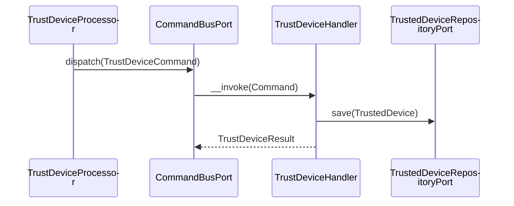
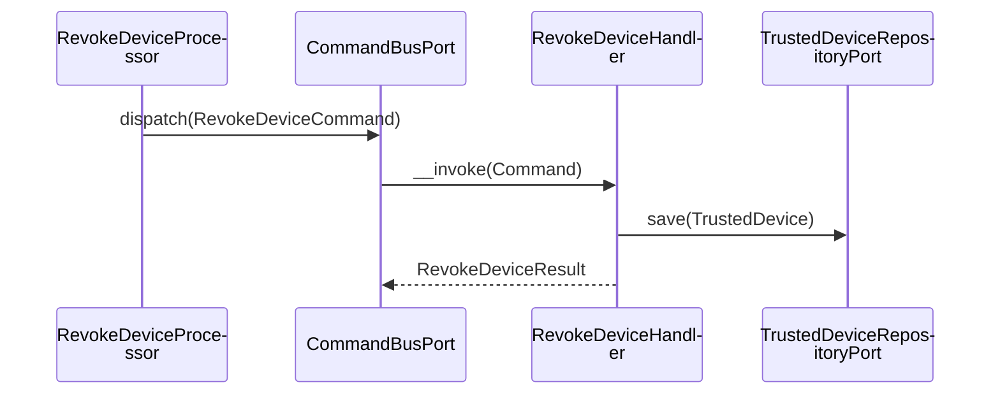
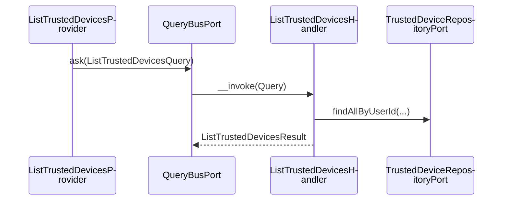

# TrustedDevice Module

**Reading guide:** [Documentation index](../../docs/README.md) · [Related guide](../../docs/guides/authentication.md).

## Overview

TrustedDevice manages device trust to allow MFA bypass for known devices.
It issues and revokes trusted device tokens, persists device metadata, and
attaches a secure cookie to the response when a device is trusted.

## API Endpoints

Operation names use the `trusted_device_` prefix to remain globally unique across
API Platform resources. The public URLs and cookie contract are unchanged.

| Resource      | Method | Path                              | Description                |
| ------------- | ------ | --------------------------------- | -------------------------- |
| TrustedDevice | POST   | `/api/trusted-devices`            | Trust the current device   |
| TrustedDevice | GET    | `/api/trusted-devices`            | List trusted devices       |
| TrustedDevice | DELETE | `/api/trusted-devices/{id}`       | Revoke a trusted device    |
| TrustedDevice | POST   | `/api/trusted-devices/revoke-all` | Revoke all trusted devices |

## Flows

### Trust Device (Command)

Trusting a device records the owner's bounded trust credential after the required identity checks. It does not replace bearer/session authorization.

### Revoke Device (Command)

The command revokes the selected trust record. Future trust checks observe the revocation while session/token lifecycles remain separately owned.

### List Trusted Devices (Query)

The query projects trusted-device records for the authorized caller. Raw trust credentials are not returned by collection serialization.

## Architecture

- Presentation: Api Platform resources, processors, providers, DTOs, cookie listener.
- Application: Use cases (Command/Query) and ports.
- Domain: TrustedDevice aggregate, value objects, and events.
- Infrastructure: Doctrine repository, mapper, and record.

Key folders:

- `src/TrustedDevice/Presentation/Api`
- `src/TrustedDevice/Application/UseCase`
- `src/TrustedDevice/Domain`
- `src/TrustedDevice/Infrastructure`

### Published and private capabilities

TrustedDeviceDataLifecyclePort owns account purge and expiration/revocation retention on auth. Consumers receive no mutable aggregates. Trust remains separate from mandatory bearer and session authorization.

Repositories and capabilities exposing owner-local types are private under Application/Port/Outbound/Internal; cross-module access uses published ports and pure contracts.

TrustedDevice publishes its global permission vocabulary through Authorization's pure
`PermissionCatalogContributionPort`. Its owner-local
`TrustedDevicePermissionContributionAdapter` is registered with
`authorization.permission_catalog_contribution`; composition rejects duplicate keys
at boot and preserves explicit publication order. This contribution defines available
permission keys and does not grant them to a subject.

## Configuration

Module selection loads [the service entry point](../../config/modules/trusted_device.yaml)
together with its [owner configuration fragments](../../config/modules/trusted_device/).
Those fragments contribute owned mappings, API/error metadata and configured
framework/seed registrations. Shared package configuration supplies connections and
manager definitions; this module's persistence remains explicitly wired to `auth`.
See the [composition standard](../../ARCHITECTURE.md#service-wiring).

- Service wiring: `config/modules/trusted_device.yaml`
- Environment:
  - `TRUSTED_DEVICE_COOKIE_NAME` (cookie base name)
  - `TRUSTED_DEVICE_LIFETIME` (seconds, default 30 days)

### HTTP idempotency

TrustedDevice declares trust and both revocation routes as auth-owned HTTP mutations
with the configured mandatory `Idempotency-Key` policy. The trust result contains a raw
credential and uses encrypted, short-lived replay. Its exact issued device must still
belong to the active caller, remain unrevoked and be unexpired. Replacing the same browser
fingerprint removes the old device and makes its stored credential ineligible for replay.
Revocation reads fresh device ownership; removed targets require signed original facts.
Current account revision and technical permissions are checked before any result decode.

## Testing

- E2E: `tests/E2E/TrustedDeviceFlowTest.php`
- Run module tests: `php -d memory_limit=1G vendor/bin/phpunit tests/E2E/TrustedDeviceFlowTest.php`

## Error Codes

No additional stable module-specific error-code catalog is declared here. The resource security, validation and exception translation define the public HTTP responses; consult this module's endpoint contracts and [OpenAPI schema](../../openapi.json). A future distinct public code must be documented in this section with its triggering condition.
